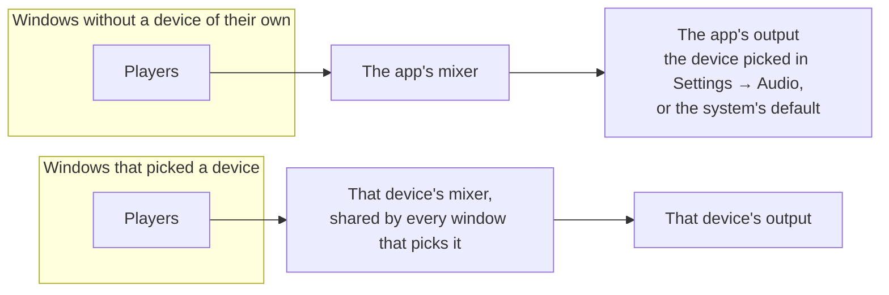

# How Plays works

Plays is written in Rust. Its UI is
[gpui](https://github.com/zed-industries/zed/tree/main/crates/gpui), from a
patched copy in `vendor/gpui`; media is decoded with FFmpeg, built from
source and linked statically. [README.md](README.md) says what it does,
[CONTRIBUTING.md](CONTRIBUTING.md) how to build and test it.

- [Overview](#overview)
- [The repository](#the-repository)
- [The media pipeline](#the-media-pipeline)
- [Pictures](#pictures)
- [Sound](#sound)
- [Subtitles](#subtitles)
- [The rest of the media engine](#the-rest-of-the-media-engine)
- [The app and its windows](#the-app-and-its-windows)
- [Casting](#casting)
- [The stream server](#the-stream-server)
- [The network crate](#the-network-crate)
- [The Chromecast crate](#the-chromecast-crate)
- [The DLNA crate](#the-dlna-crate)
- [The AirPlay crate](#the-airplay-crate)
- [Linking FFmpeg](#linking-ffmpeg)
- [Vendored gpui and xattr](#vendored-gpui-and-xattr)

## Overview

Every action, from a key, a menu or a button, runs an API command by name.
Each open file or stream is a `Player`, owned by its block: the audio
output tells its clock what is heard, and the block draws the frame the
clock has reached. A casting block's link thread drives the device through
its protocol's crate, and the stream server serves the device the file.

Threads:

- UI: gpui, everything in `src/app` and `src/ui`
- Per player: `demux` and `decode` (`src/media/decoder/`)
- Per audio output: one opening its devices (`src/app/audio.rs`), and one
  mixing: cpal's callback, AirPlay's, or a silent one (`src/media/output.rs`)
- Subtitle file readers, while a video opens (`src/media/external.rs`)
- A cover file finder for sound files (`src/media/decoder/cover_file.rs`)
- Per casting block: its link (`src/cast/link.rs`); each crate has its own
- Stream server: one per HTTP connection, one per segment job

## The repository

A Cargo workspace: Plays, and its crates in `crates/`, each built and tested
on its own. Clippy lints in the root `Cargo.toml` apply to all.

| Path | What it is |
| --- | --- |
| `src/` | Plays itself |
| `crates/stream-server` | Serves media to devices over HTTP, as is, repackaged or re-encoded |
| `crates/chromecast` | Finds and drives Google Cast devices |
| `crates/dlna` | Finds and drives UPnP media renderers |
| `crates/airplay` | Finds, pairs with and sends to AirPlay receivers |
| `crates/network` | What the casting crates share: connecting, bounded HTTP and RTSP, mDNS |
| `crates/ffmpeg-link` | Links the static FFmpeg into Plays and the stream server's tests |
| `crates/completions` | Shell completion scripts for a clap command line |
| `vendor/gpui` | gpui 0.2.2, patched |
| `vendor/xattr` | xattr 0.2.3, patched to build on Linux |
| `script/` | FFmpeg build, macOS bundle, credits, fixtures, smoke runs |
| `resources/` | Credits (`attributions.json`), macOS `Info.plist`, Linux `.desktop` |
| `assets/` | App icon and UI icons |
| `tests/fixtures` | Small media files for tests |

Inside `src/`:

| Path | What it is |
| --- | --- |
| `main.rs` | Starts the app, runs the command line, or hands files to the running Plays |
| `api/` | Every command by name, its events, and the command line's socket |
| `cli.rs`, `cli/` | The `plays` command line |
| `app/` | Startup, menus, keymap, audio outputs (AirPlay, Bluetooth), staying awake, smoke runs |
| `media/` | Playback engine: decoding, mixers, clocks, subtitles, HDR |
| `ui/` | gpui views: windows, blocks, Settings, Picture in Picture, components, theme |
| `cast/` | Casting blocks to TVs and speakers |
| `settings.rs`, `settings/` | Settings, in `plays/settings.json` |
| `progress.rs` | Where each file stopped and its tracks, 30 days, in `plays/progress.json` |
| `recents.rs` | Recent files and palette commands |
| `files.rs` | The config folder, and whole-file writes |
| `hotkeys.rs` | Command shortcuts, changeable in Settings |
| `assets.rs` | Icons compiled into the binary |

## The media pipeline

Audio is the master: the picture follows the clock, the clock follows the
sound heard. No sound, wall time.

- `src/media/decoder/demux.rs`: reads ahead (1 s, 15 s for streams), seeks
- `src/media/decoder/mod.rs`: decodes only while its queues have room
- `src/media/decoder/video.rs`, `audio.rs`, `convert.rs`: decoders, pictures
- `src/media/decoder/shared.rs`: what a player and its threads share; each
  seek starts a generation, and nothing from an earlier one is handed out
- `src/media/player.rs`: the UI-side handle, ticked as its block draws
- `src/media/clock.rs`: a per-player wall clock, eased toward the audio

## Pictures

A decoded picture reaches gpui in one of three forms
(`src/media/picture.rs`):

| Form | Where | How it is drawn |
| --- | --- | --- |
| BGRA image | macOS software decoding; on Linux, Dolby Vision and formats other than 8- and 10-bit 4:2:0 | gpui's texture atlas |
| Surface | macOS hardware decoding, zero-copy | From the `CVPixelBuffer`, with gpui's surface shaders |
| Y'CbCr planes | Most Linux frames, hardware ones copied back first | Converted and tone mapped by gpui's Vulkan shader |

- On Linux, gpui can't draw DMA-BUFs, so hardware frames are copied back
- Zero-copy: four 4K H.264 files take about 20% of a core, 100% copied back
- `src/media/hwaccel.rs`: one hardware device per API; software fallback
- `src/media/videotoolbox.rs` (macOS): `VTPixelTransferSession` converts
  and scales each frame on the GPU; HDR to 10-bit BT.2020
- `src/media/yuv.rs` (Linux): planes and their matrix;
  `PLAYS_GPU_CONVERSION=0` converts on the CPU instead
- `src/media/hdr.rs`: PQ, HLG and the tone curve; reference white as SDR white
- `src/media/dovi.rs`: Dolby Vision profile 5, reshaped by each frame's RPU
- `src/media/picture.rs`: the forms, and the gamma every player shares
- `src/media/orientation.rs`: the eight turns and mirrors
- `src/ui/player/graveyard.rs`: replaced frames, kept a few display frames
  in case the GPU still reads them, then released (`Window::drop_image`)
- HDR tone mapping: on macOS, gpui's shader under the EDR headroom, or the
  CPU for software HDR; on Linux, the GPU, or the CPU for Dolby Vision

## Sound

- `src/media/audio.rs`: a mixer per output; sums players and tells each
  clock what is heard, moved by the audio delay. It runs on the real-time
  thread, so it neither allocates nor waits.
- `src/media/output.rs`: where a mixer's sound goes: a cpal stream, an
  AirPlay speaker, or nowhere; not `Send`, so each stays on its thread
- `src/app/audio.rs`: the `AudioEngine`: the app's output, and one per
  device a window picks, each with a thread opening devices through
  `Devices` (`Local` via cpal, Bluetooth, AirPlay), so the UI never waits.
  A device gone means silence or the system default until it's back.
- `src/app/speakers.rs`: AirPlay speakers as outputs (`airplay:` ids),
  sharing `Pairings` with casting; `OpenError::NeedsPin`
- `src/app/bluetooth.rs` (macOS): paired devices, connected when picked
- `src/ui/workspace/sound.rs`: a window's own output device, if it picks one

## Subtitles

- `src/media/subtitles.rs`: cues; text through FFmpeg's ASS lines, bitmaps
  as images placed in fractions of the picture
- `src/media/external.rs`: subtitle files beside a video; encoding by
  `chardetng`, converted by FFmpeg's iconv
- `src/ui/subtitles.rs`: paints a block's cues, and the Settings preview
- `src/ui/overlay.rs`: subtitles into pixels, for screenshots and Picture
  in Picture

## The rest of the media engine

- `src/media/source.rs`: files, URLs, and folders listed in the background
- `src/media/details.rs`: the console's format and stream details
- `src/media/colors.rs`: colors read as numbers, as ffmpeg-next's enums
  have gaps a file can hit; `clippy.toml` bans its getters
- `src/media/tracks.rs`: tracks, their menu names, and languages
- `src/media/picking.rs`: which tracks play (`Wanted`): those picked
  before (`Picked`), else preferred languages, else FFmpeg's best
- `src/media/chapters.rs`: chapters
- `src/media/still.rs`: a frame decoded again at full size for a screenshot

## The app and its windows

- `src/api/`: every command, by name, which every action runs
- `src/api/commands/`: a file per namespace, each a list of `Spec`s: id
  (`playback.toggle_loop`), arguments, keys, state, the events it `tells`
- `src/api/registry.rs`, `args.rs`, `target.rs`: find the command, check
  its arguments, find the window and block named, else the one in front
- `api::run` runs an `Invocation`, answering JSON or an `Error`; keys and
  menu items send one gpui action, `api::Run`; `api::can_run` enables them
- `src/api/events.rs`, `events/`: change events, found by `events::look`
  diffing a `Seen` after each command; `kinds.rs` registers each kind
- `src/api/socket.rs`, `socket/`: the socket, only this user's, there
  only while Settings has the command line on; JSON a line; requests run
  on the UI thread; a second Plays hands files over
- `src/cli.rs`, `src/cli/`: the command line, a client of that socket;
  `reference.rs` writes `docs/commands.md`; `lua.rs` runs `plays do`'s
  Lua scripts ([docs/lua.md](docs/lua.md))
- `src/app/mod.rs`, `keymap.rs`, `menus.rs`: startup, keys and menu bar
- `src/app/windows.rs`, `history.rs`: window numbers and `FocusHistory`
- `src/app/awake.rs`: keeps the screen awake while video plays
- `src/app/smoke.rs`: scripted runs of the real app (see
  [CONTRIBUTING.md](CONTRIBUTING.md#smoke-runs))
- `src/hotkeys.rs`: every command's keys, bound in the context their
  `Reach` gives; none in `Recording`
- `src/settings.rs`, `src/settings/fields.rs`: settings as JSON, each value
  read on its own; `settings::fields` lists every setting by key
- `src/files.rs`: the config folder; files written beside, then renamed over
- `src/recents.rs`, `src/progress.rs`: recent files; each file's place, tracks
- `src/ui/workspace/`: a window, a file per part: opening, blocks, grid,
  focus, fitting, placing, full screen, sound, the empty window
- `src/ui/player/`: a block, a file per part; `playback.rs` holds its
  `Player` and the device it casts to, and every command goes through it
- `src/ui/player/mod.rs`: `BlockLayout`, where the window says each block is
- `src/ui/player/failed.rs`: a block whose drawing panics says why and stops
- `src/ui/player/sound.rs`: a sound file's title, artist, album and quality
- `src/ui/player/visualizer.rs`: what's drawn behind a sound file, a gpui
  shader
- `src/ui/pip/` (macOS): frames to an `AVSampleBufferDisplayLayer` that
  `AVPictureInPictureController` shows, pumped on a timer of its own
- `src/ui/settings/`: a file per pane; controls set through `app.settings.set`
- `src/ui/palette/`: command palette and Go to…, listing what can run there
- `src/ui/displays.rs`, `blackout/`: displays, and blacking out the others
- `src/ui/framing.rs`, `screenshot.rs`: a block's picture, and saving it
- `src/ui/components/`, `theme.rs`: `RenderOnce` components, and the theme
- `src/ui/gallery.rs`: debug-only Component Gallery

## Casting

- `src/cast/target.rs`: a protocol is a `Target`, which finds devices and
  connects to one for a `Session`; `NeedsPin` and `pair` for pairing
- `src/cast/mod.rs`: `Casting`, a global: a target per protocol Settings
  have on; starts the stream server, on every interface, for the first cast
- `src/cast/link.rs`: a block's `Link`, a thread running its session, as
  every call may wait on the network; dropped, it stops the device
- `src/cast/chromecast.rs`: subtitles as WebVTT beside the HLS
- `src/cast/dlna.rs`: the files the renderer lists, else MPEG-TS, as fewer
  TVs take HLS; subtitles as SRT
- `src/cast/airplay.rs`: always HLS, subtitles in the playlist; speakers
  are outputs, not cast to
- `src/cast/pairings.rs`: AirPlay credentials, owner-only (`AppPairings`)
- `src/ui/pairing.rs`, `src/ui/workspace/pairing.rs`: the PIN sheet
- `src/cast/fake.rs`: a protocol for tests

## The stream server

`crates/stream-server` makes the URL a protocol's crate tells a device to
play. It knows nothing of Plays or gpui.

- `profile.rs`: what a device plays: containers, codecs, size, HDR
- `media.rs`: opening and reading media
- `plan.rs`: the least work that plays, each track copied or re-encoded
- `encode.rs`: hardware video encoders only (VideoToolbox, NVENC, VA-API)
- `segments.rs`: copied video cut at its keyframes, else every six seconds
- `mux.rs`: fragmented MP4, MPEG-TS, ADTS or FLAC, written into memory
- `job.rs`: segments made three ahead of the device; a seek starts another
- `overlay.rs`: picture subtitles drawn into re-encoded video
- `subtitles.rs`: text subtitles as WebVTT or SRT
- `playlist.rs`: the master, media and subtitle playlists
- `http.rs`, `server.rs`: HTTP/1.1, a thread per connection, a token per cast

## The network crate

`crates/network`: what the Chromecast, DLNA and AirPlay crates share.

- `connect_first`: tries each of a device's addresses in turn
- `http`: HTTP and RTSP read in bounds; a `Deadline` times a whole message
- `mdns` (feature `mdns`): browsing; each crate's `Protocol` says what for
- `Found` (a device added, changed or gone), and `lock` for poisoned mutexes

## The Chromecast crate

`crates/chromecast` finds Google Cast devices and drives them. No Plays,
gpui or FFmpeg; it blocks, and says what happens over a channel.

- `browser.rs`, `device.rs`: mDNS for `_googlecast._tcp`
- `channel.rs`, `proto.rs`: TLS (rustls) carrying `CastMessage` protobufs
- `session.rs`: launches or joins the Default Media Receiver; status as events
- `media.rs`: LOAD and the media status
- `fake.rs` (feature `fake`): a pretend device
- `cargo run -p chromecast --example chromecast -- list` lists devices

## The DLNA crate

`crates/dlna` finds UPnP media renderers and drives them, like the
Chromecast crate.

- `ssdp.rs`, `browser.rs`: SSDP on `239.255.255.250:1900`, IPv4 only
- `device.rs`, `xml.rs`: device descriptions, read into capabilities
- `http.rs`, `soap.rs`: just enough HTTP/1.1, and SOAP actions
- `media.rs`: DIDL-Lite, subtitles as Samsung's `sec:CaptionInfoEx` too
- `session.rs`: AVTransport, RenderingControl; GENA events, else polling
- `fake.rs` (feature `fake`): a pretend renderer
- `cargo run -p dlna --example dlna -- list` lists renderers

## The AirPlay crate

`crates/airplay` finds AirPlay receivers and pairs with them: a TV is told
to play a URL, a speaker is sent live sound. Built like the other two.
Apple's protocol is unpublished, so an update can break it.

- `browser.rs`, `device.rs`: mDNS for `_airplay._tcp` and `_raop._tcp`
- `tlv8.rs`, `srp.rs`, `pairing.rs`: HomeKit pairing (SRP-6a, Ed25519,
  ChaCha20-Poly1305); a `403` is `Error::Refused`
- `channel.rs`, `message.rs`, `connection.rs`: RTSP and HTTP on one TCP
  connection, encrypted once paired
- `session.rs`: AirPlay 2's session; OPTIONS for AirPlay 1
- `video.rs`: `/play`, `/rate`, `/scrub`, `/stop`, `/playback-info`
- `audio.rs`, `rtp.rs`, `rsa.rs`: 16-bit stereo PCM at 44.1 kHz in RTP,
  sealed for AirPlay 2, plain or AES-128 for AirPlay 1
- `fake.rs` (feature `fake`): a pretend receiver
- `cargo run -p airplay --example airplay -- list` lists receivers

## Linking FFmpeg

- `script/build-ffmpeg` builds FFmpeg into `build/ffmpeg-9.0.2`, where
  `.cargo/config.toml` points `FFMPEG_DIR` (see
  [CONTRIBUTING.md](CONTRIBUTING.md#building))
- ffmpeg-sys-next makes bindings again only when `FFMPEG_DIR` changes, so
  each version gets a folder of its own
- `build.rs` and `crates/ffmpeg-link` link it statically, with what its
  pkg-config files name
- Linking is a crate of its own: a build script's link arguments reach only
  its own package, and the stream server links FFmpeg too

## Vendored gpui and xattr

- `vendor/gpui`: gpui 0.2.2, through `[patch.crates-io]` in `Cargo.toml`,
  for HDR, GPU video conversion on Linux, pictures turned and cropped,
  backdrops, visualizers, floating windows, displays and full screen, and
  tests
- Every change is marked "Plays" and listed in `vendor/gpui/PLAYS.md`
- `vendor/xattr`: xattr 0.2.3, building on Linux; `vendor/xattr/PLAYS.md`
  says when to drop it
