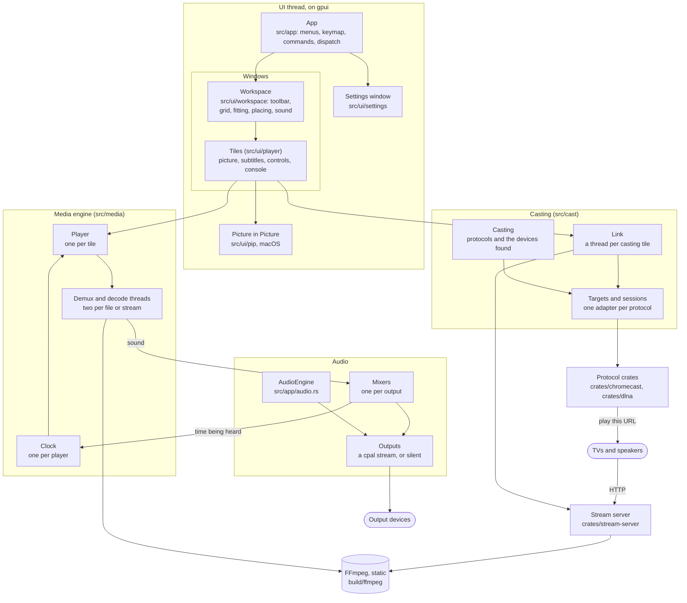
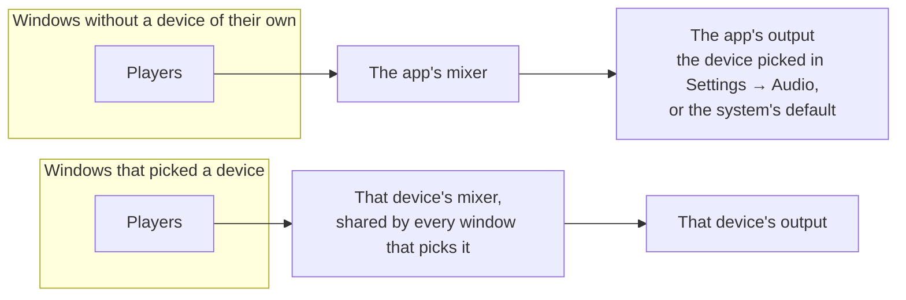
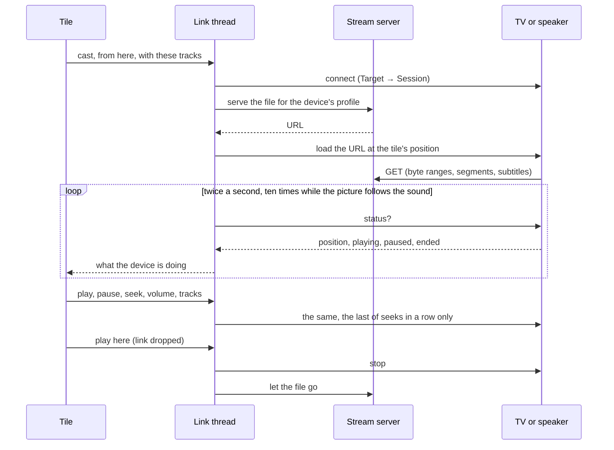
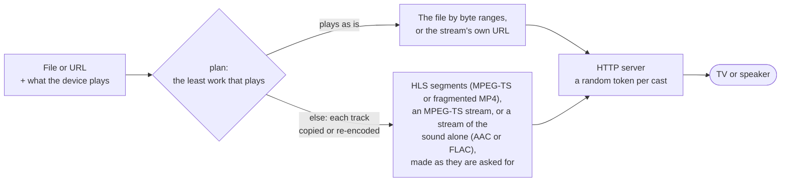

# How Plays works

Plays is written in Rust. Its UI is built with
[gpui](https://github.com/zed-industries/zed/tree/main/crates/gpui), Zed's
GPU-accelerated UI framework, from a patched copy in `vendor/gpui`. Media
is decoded with FFmpeg, built from source and linked in statically. This
file describes how the parts fit together. [README.md](README.md) says what
the app does, and [CONTRIBUTING.md](CONTRIBUTING.md) says how to build and
test it.

- [Overview](#overview)
- [The repository](#the-repository)
- [The media pipeline](#the-media-pipeline)
- [Pictures](#pictures)
- [Sound](#sound)
- [Subtitles](#subtitles)
- [The rest of the media engine](#the-rest-of-the-media-engine)
- [The app and its windows](#the-app-and-its-windows)
- [Casting](#casting)
- [The stream server](#the-stream-server)
- [The Chromecast crate](#the-chromecast-crate)
- [The DLNA crate](#the-dlna-crate)
- [The AirPlay crate](#the-airplay-crate)
- [Linking FFmpeg](#linking-ffmpeg)
- [Vendored gpui and xattr](#vendored-gpui-and-xattr)

## Overview

gpui runs the app on one thread: windows, views, menus and settings. Each
open file or stream is a `Player`, owned by its tile, with two threads of
its own that read and decode it. Decoded sound goes into a mixer, which an
audio output plays; the output tells each player's clock what is being
heard, and the tile shows the frame the clock has reached each time gpui
draws. A tile that casts hands its file to a link thread, which drives the
device through its protocol's crate, while the stream server serves the
device the file.

The threads, then:

- the UI thread, where gpui runs everything in `src/app` and `src/ui`;
- two per player, `demux` and `decode` (`src/media/decoder.rs`);
- one per audio output: cpal's callback, or a thread that runs the mixer in
  time when there is no device (`src/media/output.rs`);
- one per casting tile (`src/cast/link.rs`), and the threads each protocol's
  crate runs its sessions and discovery on;
- the stream server's: one per HTTP connection, and one per job making
  segments (`crates/stream-server`).

## The repository

The repository is a Cargo workspace: Plays, and beside it in `crates/` the
crates it is built from, each built and tested on its own.

| Path | What it is |
| --- | --- |
| `src/` | Plays itself. |
| `crates/stream-server` | Serves media to TVs and speakers over HTTP, as they play it or repackaged and re-encoded for them. |
| `crates/chromecast` | Finds Google Cast devices and drives them. |
| `crates/dlna` | Finds UPnP media renderers and drives them. |
| `crates/airplay` | Finds AirPlay receivers, pairs with them and sends to them. Plays doesn't use it yet. |
| `crates/ffmpeg-link` | Links the static FFmpeg into Plays and into the stream server's tests. |
| `vendor/gpui` | gpui 0.2.2, patched for Plays. |
| `vendor/xattr` | xattr 0.2.3, which gpui reaches, patched to build on Linux. |
| `script/` | Building FFmpeg, bundling the macOS app, the credits, test fixtures and smoke runs. |
| `resources/` | The credits (`attributions.json`), the macOS `Info.plist` and the Linux `.desktop` file. |
| `assets/` | The app icon, which `script/bundle-macos` compiles into the app bundle, and the UI's icons, which `src/assets.rs` compiles into the binary. |
| `tests/fixtures` | Small media files the tests open. |

Inside `src/`:

| Path | What it is |
| --- | --- |
| `main.rs` | Starts the app. |
| `app/` | Starting the app, its actions, menus, keymap, audio outputs, keeping the computer awake, smoke runs. |
| `media/` | The playback engine: FFmpeg decoding, the mixers, clocks, subtitles, HDR. |
| `ui/` | gpui views: windows, tiles, Settings, Picture in Picture, components and theme. |
| `cast/` | Casting tiles to TVs and speakers. |
| `settings.rs` | The settings, saved as `plays/settings.json` in the user's config folder. |
| `progress.rs` | Where each file was when it last played, kept for 30 days in `plays/progress.json`, so it starts there again. |
| `files.rs` | Writing those two files whole, so a crash never leaves one half written. |
| `hotkeys.rs` | The commands shortcuts run, and their keys. |
| `assets.rs` | Icons compiled into the binary, so the app needs no files next to it. |

## The media pipeline

Audio is the master: the picture follows the clock, and the clock follows
the sound being heard. A file with no sound plays on wall time.

- `src/media/decoder.rs`: two threads per file or stream. The demux thread
  reads packets ahead (about a second for files, up to 15 s for network
  streams so a slow connection doesn't stall decoding) and carries out seeks.
  The decode thread decodes only while its output queues have room, so
  memory stays bounded however much is read ahead. It converts video to
  BGRA `RenderImage`s (with the right YUV matrix and pixel aspect), except
  where frames stay on the GPU (macOS) or go over as their Y'CbCr planes
  (Linux); resamples audio to the mixer's rate; and handles accurate
  seeking: frames no other frame refers to aren't decoded on the way to a
  seek's target. A skip (the arrow keys, the skip buttons) is accurate when
  a keyframe is within a second before its target, and otherwise lands on
  the nearest keyframe its way, which shows at once. Dragging the seek bar
  scrubs: each move shows the first frame decoded on its way at once, then
  one every 40 ms or so, then the frame asked for, decoding nothing past it
  and no sound, so nothing waits on buffering. A move up to two seconds past
  the frame decoded last decodes on from there rather than going back to a
  keyframe. Letting go seeks exactly. It plays one track of each kind;
  picking an audio or video track opens a decoder for it and seeks to the
  playhead, so the new track starts where playback is. The other subtitle
  tracks' packets are kept for a few seconds, so a subtitle track picked
  starts with them, without a seek.
- `src/media/player.rs`: the UI-side handle: play/pause/seek, frame
  selection, buffering after seeks (and, for streams, until a second is
  read ahead or when the network runs dry), end-of-file and looping, and
  the console's figures: frames shown and dropped, lateness, and what is
  queued. A tile ticks its player each time it is drawn; while the window
  isn't drawing (hidden or minimized), the window ticks every tile five
  times a second so playback, end of file and looping go on.
- `src/media/clock.rs`: per-player clock that runs on wall time and is eased
  toward the audio position on every audio callback. Drift too large to
  ease snaps it.

## Pictures

A decoded picture reaches gpui in one of three forms (`src/media/picture.rs`):

| Form | Where | How it is drawn |
| --- | --- | --- |
| BGRA image | Software-decoded frames on macOS; on Linux, Dolby Vision and formats other than 8- and 10-bit 4:2:0 | Uploaded to gpui's texture atlas. |
| Surface | Hardware-decoded frames on macOS (zero-copy) | Drawn in place from the `CVPixelBuffer`, with gpui's surface shaders. |
| Y'CbCr planes | Most frames on Linux, hardware-decoded ones copied back first | Uploaded as planes, converted (and HDR tone mapped) by gpui's Vulkan shader. |

gpui's Linux renderer can't draw GPU surfaces such as DMA-BUFs, which is
why hardware-decoded frames are copied back there. Either way the tile
paints them itself, framed. Replaced frames are kept a
few display frames in case the GPU is still reading them, then released
(images with `Window::drop_image`, from `src/ui/player/graveyard.rs`), and
so are the pictures of DVD, Blu-ray and DVB subtitles once they are off
screen, so GPU memory stays flat during playback.

Playing four 4K H.264 files at once on an Apple silicon Mac takes about 20%
of one core with zero-copy, against about 100% when hardware frames are
copied back and converted on the CPU.

- `src/media/hwaccel.rs`: shares one hardware device per API between all
  decoders and copies GPU frames back for conversion where they can't be
  drawn directly. If the GPU can't take a stream, or keeps failing on it,
  decoding switches to software.
- `src/media/videotoolbox.rs` (macOS): the zero-copy path. A
  `VTPixelTransferSession` converts each VideoToolbox frame on the GPU into
  the full-range NV12, BT.601 surface gpui's `surface()` element draws,
  scaling it to the display size on the way. Untagged video gets the same
  matrix guess as in software (BT.709 from 720 lines up). HDR frames go to
  10-bit BT.2020 surfaces tagged with their transfer function instead, and
  Dolby Vision frames are only scaled, carrying their reshaping along.
- `src/media/yuv.rs` (Linux): frames handed to gpui as their Y'CbCr planes
  (`yuv420p`, `nv12`, 10-bit `yuv420p10` and `p010`, which hardware decoders
  give), with the matrix from samples to R'G'B' for their YCbCr matrix,
  range and bit depth, and where their chroma samples sit. The CPU only
  copies the planes, or has swscale scale them (still as Y'CbCr) when the
  picture is over the resolution limit or its pixels aren't square; gpui
  converts them to RGB, tone maps HDR and applies the gamma on the GPU.
  Dolby Vision and other formats are converted on the CPU as before, and
  `PLAYS_GPU_CONVERSION=0` sends every frame that way.
- `src/media/hdr.rs`: PQ and HLG, and the tone curve. HDR reference white
  (203 nits) is shown as SDR white, and brightness above three quarters of
  the screen's headroom eases toward it instead of clipping. On the CPU it
  turns HDR frames, scaled to 16-bit RGB by swscale, into 8-bit sRGB.
- `src/media/dovi.rs`: Dolby Vision profile 5, whose pictures are IPT
  rather than YCbCr. Each frame's reshaping curves and matrices (from its
  RPU, which FFmpeg parses) turn it into BT.2020 light like HDR10's. On the
  CPU from 16-bit 4:4:4 planes; for zero-copy surfaces, the curves are
  packed for gpui's Dolby Vision shader instead.
- `src/media/picture.rs`: the forms a decoded picture takes, and the gamma
  for SDR and HDR video that every player shares. Converted frames get it on
  the CPU; surfaces carry it to gpui's shaders each time they are drawn, so a
  change shows at once, even on paused video.
- `src/media/orientation.rs`: the eight ways to turn and mirror a picture,
  and the one a video's display matrix asks for.

Where HDR is tone mapped, then: on macOS, VideoToolbox surfaces are tone
mapped by gpui's shader under the screen's current EDR headroom, and
software-decoded HDR on the CPU to SDR; on Linux, on the GPU to SDR, with
Dolby Vision on the CPU.

## Sound

- `src/media/audio.rs`: the mixers, one for each output, which sum all
  players and apply per-player and master volume. A mixer tells each
  player's clock what is being heard, moved by the player's audio delay, so
  the picture runs that far ahead of the sound (or behind it). It plays at
  the output's rate; when a new device wants another, or a player moves to
  another mixer, what is queued is converted to the new rate and decoders
  resample to it from then on.
- `src/media/output.rs`: where a mixer's sound goes: a cpal stream to a
  device, in the device's own format, or, with no device, a thread that
  runs the mixer in time so players keep playing silently. It lists the
  outputs and finds one by the id the system keeps for it. On macOS it
  adds the latency CoreAudio gives the device's stream, which cpal leaves
  out and AirPlay makes long, to how late what is mixed will be heard, and
  CoreAudio says when outputs come and go. Elsewhere the list is read again
  when it is shown.
- `src/app/audio.rs`: the `AudioEngine`, which keeps the outputs and
  which device each plays through. The app's output plays through the
  device picked in Settings → Audio, or the system's default. A window may
  play through a device of its own instead: the engine keeps an output,
  with its own mixer, for each device a window picked, shared by every
  window that picks it and closed with the last of them, routed and watched
  like the app's. While a device picked isn't connected, its sound waits
  for it (players keep playing, silently) or goes through the system's
  default, as settings say; the device is looked for every two seconds, and
  the sound goes back to it as soon as it's there. In tests, the outputs
  play nowhere and no device is listed or opened.
- `src/ui/workspace/sound.rs`: a window's sound, through the app's output
  or a device of its own. Its tiles play there, and a tile moved to a new
  window takes the device along. A window Output Device sends full screen
  to another display plays through the output named after that display,
  its speakers, while there, unless a device was picked for it; coming back,
  it plays as it did before. An output is named after a display when its
  words are the display's, or, failing that, when it is the one output
  whose words take in the display's or are taken in by them.

## Subtitles

- `src/media/subtitles.rs`: subtitle cues. Subtitle packets are decoded as
  soon as they are read. FFmpeg turns every text format into ASS lines, of
  which the words, line breaks, italics, bold and top/middle/bottom placement
  are kept; bitmaps become images placed as fractions of the picture. A
  cue without an end (as in PGS) lasts until the next one. Cues show by the
  playhead less the subtitle delay. Seeks keep them, from a minute before
  the playhead to a minute after, so stepping or skipping back shows the
  ones just over at once (even one that started before the keyframe the
  seek reads from), and moving subtitles later brings them back. A cue read
  again is kept once.
- `src/media/external.rs`: subtitle files beside a video: finding them,
  reading their names, and telling a text file's encoding (with `chardetng`)
  for FFmpeg's iconv to convert. A picked file is read whole and its packets
  decoded two seconds ahead of the playhead; after a seek, from 30 seconds
  before it, so cues already showing are there.
- `src/ui/subtitles.rs`: paints a tile's cues on the picture it frames, in
  the style from Settings, turning and cropping bitmap ones with it; the
  settings' Subtitles pane draws its preview with the same code.
- `src/ui/overlay.rs`: draws subtitles into pixels rather than with gpui,
  for screenshots and Picture in Picture: text laid out by `subtitles` as
  on a tile showing just the picture, drawn with the glyphs gpui
  rasterizes, and bitmaps stretched where the stream places them.

## The rest of the media engine

- `src/media/source.rs`: files and stream URLs. URLs are logged without
  credentials or query strings. Folders are listed (for the media files in
  one dropped, and a file's previous and next) in the background, as they
  may be on a network drive, and by name without looking at each file.
- `src/media/details.rs`: what the console shows of the file's format and
  the streams playing, read from their decoders before they decode.
- `src/media/tracks.rs`: the tracks a file has, and their names for the
  menu (language, title, forced and SDH, codec, channels).
- `src/media/chapters.rs`: a file's chapters, read with its info (their
  times from the start of the file, in order), and which one a time is
  in, the next and the previous. Going back within the first couple of
  seconds of one goes to the one before, as on a disc player; later, to
  its start.
- `src/media/still.rs`: a frame decoded again on its own for a screenshot:
  the file opened again, sought to the keyframe before the frame shown and
  decoded in software up to it (found by its timestamp), then converted at
  full size, tone mapped as playback does, or as BT.2020 PQ or HLG.

## The app and its windows

- `src/app/`: starting the app and its own actions (`mod.rs`), the shared
  audio outputs (`audio`, above), what each action does (`commands`), how
  actions reach the window and tile in front (`dispatch`), the keymap
  (`keymap`: the app's own shortcuts and the playback ones from Settings,
  bound again whenever they change) and the menu bar (`menus`, set again
  as outputs, displays or devices to cast to come and go, another is
  picked, or the tile in front casts, turns out to have no sound, is shaped
  or cropped, or another tile is in front). `awake` keeps the screen awake
  while a video plays, and the computer while only sound does: a power
  assertion on macOS, the desktop portal's Inhibit on Linux. `smoke` runs
  the real app through scripted scenarios (see
  [CONTRIBUTING.md](CONTRIBUTING.md#smoke-runs)).
- `src/hotkeys.rs`: the commands shortcuts can run, their default
  keys, how they are saved in Settings and shown (`⌃⌘F`, `Ctrl+Alt+F`).
  Each command has a gpui action, bound in the `Workspace` key context so
  single keys such as space don't fire while typing elsewhere. The keymap
  is rebuilt from them whenever they change, and the menus show them.
- `src/settings.rs`: the settings, saved as JSON in the user's config
  folder with the version of Plays they're from. Each value is read on
  its own, so one a setting can't take (typed wrong, or from a later
  Plays) leaves only that setting as it starts out; a file not read
  whole, or from a later Plays, is kept beside it as `settings.json.bad`.
- `src/files.rs`: writing the settings and progress whole: to a file
  beside first, on the disk, then renamed over the old one, so a crash or
  losing power midway leaves the old one as it was.
- `src/progress.rs`: where each file was when it last played, by its
  whole path, kept for 30 days in `progress.json` beside the settings.
  Tiles note it as they close or open another file, every 10 seconds
  while files are open, and as the app quits; a tile opening a file seeks
  to it. A file barely begun, or played nearly to its end, isn't kept.
- `src/ui/`: gpui views (`open_url`, the player and Settings below) and a
  text field based on gpui's input example (`text_input`).
  - `displays` lists the displays by the names macOS gives them (on X11,
    each monitor by its product's name; on Wayland, each output by the
    compositor's description) and moves a window onto one, which gpui
    can't. New windows open on the display in use.
  - `framing` works out how a tile's picture shows: the file's
    orientation, then the tile's turns, flips, aspect ratio and crop, as a
    size to fit and where to sample the frame.
  - `screenshot` saves a tile's frame: bitmap subtitles laid on it, then
    turned and cropped on the CPU as `framing` says, then text subtitles,
    and written as PNG (with `png`, which can tag HDR) or JPEG.
  - `blackout` covers the other displays while a window is full screen,
    with plain black windows of the system's own rather than gpui's, as
    nothing is drawn in them and they must never take the focus: on macOS
    above the menu bar and Dock, on every Space; on X11 one per monitor,
    override-redirect so the window manager leaves it alone. Wayland lets
    no app place windows, so there it does nothing.
  - `traffic_lights` fades the macOS traffic lights with the controls;
    gpui draws them over the video but has no way to hide them.
    `system_colors` reads macOS's own colors and the accent color from
    AppKit. `about` is the About window.
- `src/ui/workspace/`: a window, one per window, a file per part: opening
  files, folders and streams (`opening`), the tiles, putting one in
  another's place and moving one to its own window (`tiles`), sizing the
  window for the videos opened in it (`fit`), the grid, where a tile
  dragged onto another lands (`grid`), the empty window's ring (`empty`), the
  toolbar (`toolbar`), the mouse coming, going and resting, and the traffic
  lights (`mouse`), floating on top (`on_top`), where windows open and come
  back to (`place`), going full screen on another display (`display`: out
  of full screen, across, and in again), the window's sound (`sound`), and
  what the Playback commands do to every tile (`commands`).
- `src/ui/player/`: a player's tile, a file per part: what fills it
  (`content`), the header, the controls, the track menu, notes on what
  shortcuts did (`osd`, with the track reel), the `console`, what
  shortcuts do to it (`commands`, `adjust` for the picture, `sync` for
  delays and `screenshot`; `pip` runs Picture in Picture for it, `cast`
  casts it), dragging it by its picture (`drag`: with gpui's drag and drop
  onto another tile, or the window with `Window::start_window_move` when
  no other tile shows), and the graveyard frames wait in before they are
  released.
  While a tile casts, its play, pause, seek, volume, loop and track changes
  go to the device, Picture in Picture's buttons too, and what it shows
  (position, playing, the end) comes from it. Picture in Picture closes,
  and isn't offered, while the picture plays on the device.
- `src/ui/pip/` (macOS): Picture in Picture. The tile's frames go, as they
  are due, to an `AVSampleBufferDisplayLayer` hidden over the tile, which
  AVKit's `AVPictureInPictureController` shows in the system's window; a
  delegate of Plays' own answers its buttons. The tile pumps its player on
  a timer of its own, since gpui stops drawing a covered window. VideoToolbox
  surfaces go as they are, tagged with their colors (HDR included); other
  frames are copied into BGRA buffers, and turned or mirrored videos are
  turned on the GPU. AVKit moves the layer's video into its window at a size
  and scale of its own rather than fitted to it, so Plays keeps it filling
  the window. Subtitles can't go over the video there, so while any show,
  frames are scaled to the window's pixels on the GPU and the subtitles
  drawn into them (`burn_in`), in the frame's own signal and samples.
- `src/ui/settings/`: the Settings window. Each pane (Playback, Audio,
  Video, Subtitles, Casting, Screenshots, Hotkeys, Appearance, About) is a
  file of its own with its name and icon for the sidebar; `form` has the
  cards, rows and sliders they are made of, and `file` the settings file's
  menu at the sidebar's foot. About shows the version and the credits, each
  of which opens to its license.
- `src/ui/components/`: the reusable components, one `RenderOnce`
  component per file, each in three sizes (small, medium, large) with its
  numbers for each in `theme`. An icon; a button in seven variants
  (normal, primary, secondary, danger, ghost, link, icon) with its icon
  on either side, and selected or disabled; a switch, a segmented control,
  a slider (with notches, which the seek bar puts at chapters) and a meter;
  menu rows, and a popover that opens a menu from a button; a badge; a flat
  card; and a floating panel to put anything in, a menu's or a note's over
  the picture, which shows the picture through it as Settings say.
- `src/ui/theme.rs`: colors, every size, radius and duration the UI uses,
  the backdrop each look of the panels over the video has, and named text
  styles (`text_display`, `text_title`, `text_heading`, `text_label`).

## Casting

- `src/cast/`: casting. A protocol is a `Target`, which finds devices (a
  name, what they show, video or sound only, and an address) and connects
  to one for a `Session`: what it plays, for the stream server, then load,
  play, pause, seek, volume, subtitles, stop and status. Each protocol's
  crate is adapted to these (`target.rs`). `Casting`, a global, keeps the
  protocols, starting each one Settings have on looking (its target) and
  dropping it when turned off, which stops it looking. It is dropped on a
  thread of its own, as stopping waits for the target's threads to end,
  which can take a second, and the windows would stop drawing meanwhile; a
  cast to one of its devices goes on, its link holding the target. It asks the targets every
  second what they have found, and starts the stream server for the first
  cast, on every interface.
- `src/cast/link.rs`: a tile's `Link` runs its session on a thread of its
  own, as every call may wait on the network: it connects, has the stream
  server serve the file with the tracks the tile plays, and loads it at the
  tile's position; then it does what the tile sends it (seeks in a row only
  the last), asks the device what it is doing twice a second (ten times
  while the picture follows the sound), and shows the tile what it asked
  for until the device has done it. A video's sound sent to a speaker is
  the one cast with the picture here: the tile keeps playing with its sound
  unheard, playing and pausing as the speaker is seen to and following
  where it says it is, the time it said it at moved on to now; its clock
  eases there, and seeks where it is far off. Dropping the link stops the
  device and the stream server lets the file go; as the app quits, where
  each device was is kept to resume from, and the app waits a moment for
  the devices to stop.
- `src/cast/dlna.rs` adapts the DLNA crate: it asks each renderer found
  what it plays (its protocol info), which decides whether it shows video
  and how the stream server serves it (the files it lists, else a stream of
  MPEG-TS rather than HLS, which fewer TVs take; H.264 and AAC in MPEG-TS
  for one that doesn't say; for a speaker given a video's sound, a stream
  of AAC or FLAC, by what it lists), and names the MIME type as the
  renderer lists it. While the picture follows the sound it asks the
  renderer where it is ten times a second. A stream of the sound starts
  where its URL says: a speaker refuses to seek in one and says how long it
  is as how much it has played, so it's given the stream from where it's to
  start, again to seek, and where it says it is counts from there, against
  the file's duration. Subtitles go as SRT, both ways the crate writes them;
  other subtitles load the file again from where it is. The renderer
  stopping after it played is the end; a seek it refuses while stopped is
  made once it plays; something else playing there ends the cast. DLNA has
  no volume for the media apart from the renderer's own, so the tile's
  scales that.
- `src/cast/chromecast.rs` adapts the Chromecast crate: devices that show
  video are offered for anything, speakers and groups for sound; the model
  each says it is decides how the stream server serves it, and HLS made for
  it says its kind of segments, which the receiver otherwise takes for
  MPEG-TS. Subtitles go as a WebVTT track styled from Settings, beside the
  HLS rather than in it; off and on is the track's, other subtitles load the
  media again with a track at a URL it hasn't fetched. The tile's volume
  is the stream's. Played to the end, it's loaded again to play again; it
  going idle stopped, or unable to play, ends the cast, as the crate's ways
  of ending do.
- `src/cast/fake.rs` is a protocol for tests: devices the test adds and
  takes away, which do as they are told, keep what they were told, and say
  what the test has them say.

## The stream server

`crates/stream-server` serves media to TVs and speakers over HTTP: a
protocol's crate tells a device to play a URL, and this crate makes that
URL. It knows nothing of Plays or gpui, so it is tested on its own.

- `profile.rs`: what a device plays, as its protocol's crate knows it: the
  containers it takes as files, HLS (with MPEG-TS or fragmented MP4
  segments), a progressive MPEG-TS stream or a progressive stream of the
  sound alone (AAC as ADTS, or FLAC), and the codecs, size, bit
  depth, HDR kinds and channels it decodes; whether the HLS playlist lists
  the subtitles, which it doesn't for a device given them beside it.
- `media.rs`: opening a file or stream and reading what is in it.
- `plan.rs`: the least work that plays. The file as it is, or a stream's
  own URL, when the device plays it with the default tracks; else HLS, or
  for a DLNA TV without it an MPEG-TS stream, and for a DLNA speaker given
  a video's sound a stream of it alone, each track copied when the
  device decodes it and re-encoded when it doesn't. Video is re-encoded to
  H.264 or HEVC (10-bit and HDR kept in HEVC where the device shows them),
  no bigger than the device shows; sound to AAC, AC-3, E-AC-3 or (for a
  stream of FLAC) FLAC. Picture subtitles picked from the media are drawn
  into video re-encoded; video copied goes without them.
- `encode.rs`: the hardware video encoders only, VideoToolbox on macOS and
  NVENC or VA-API on Linux, each tried once and remembered; FFmpeg's own
  sound encoders, through a resampler and a FIFO of whole frames.
- `segments.rs`: where a file's segments start. Copied video can be cut
  only at its own keyframes, read from the file's index (or, with none, by
  reading the file); re-encoded video and sound alone are cut every six
  seconds, with a keyframe made there. A file is at most 100,000 segments
  long, about a week: one claiming to last longer is taken to end there.
- `mux.rs`: fragmented MP4, MPEG-TS, ADTS or FLAC written in memory, cut
  into segments where told. Every timestamp is moved ten seconds later, so
  none is negative and segments made by different jobs line up.
- `job.rs`: making them. A job reads from where a segment starts, copies or
  re-encodes, and cuts where the leading stream (video, else sound) reaches
  the next segment's start, holding the other stream's packets past it
  until then. Jobs run three segments ahead of the device and wait; asking
  for one far from the job (a seek), or behind it and no longer kept,
  starts another there, and a segment is cut the same way whichever job
  makes it. Packets without a length get
  one from the next. A live stream has one job, keeping the last ten
  segments and listing six; a progressive stream is made for each request,
  from the time it asks for.
- `overlay.rs`: picture subtitles drawn into video as it is re-encoded.
  The track's packets are decoded as the media is read; a display set
  shows until the next or its own end, and one with nothing in it clears
  the screen. Its pictures, their canvas stretched over the frame
  (interpolated larger, averaged smaller), are blended into each NV12 or
  P010 frame in the frame's colors, their white at graphics white in PQ
  and HLG.
- `subtitles.rs`: a text track of the media, or a subtitle file (from the
  encoding it is said to be in), read once and written as WebVTT (whole, or
  for each HLS segment, mapped to the media's timestamps) or SRT, keeping
  italics and bold.
- `playlist.rs`: the master playlist (bandwidth, size, frame rate,
  subtitles, and codec names read from each stream's parameter sets) and
  the media and subtitle playlists, each made once for a file.
- `http.rs`, `server.rs`: a small HTTP/1.1 server with a thread for each
  connection, at most 64 at once, kept open between requests for 30
  seconds, in which the next request's head must all come: GET, HEAD and
  OPTIONS, byte ranges, CORS for Chromecast, and DLNA's headers (content
  features, time seeks, Samsung's subtitles header). Each cast is served
  under a random token, at the address the device reaches this computer
  at, and only to that device. The app starts the server for a cast and it
  stops once no cast uses it.

It re-encodes video only on a hardware encoder, so a computer without one
(Linux without NVENC or VA-API) can't cast video a device doesn't play as
it is.

## The Chromecast crate

`crates/chromecast` finds Google Cast devices (Chromecasts, Google TVs,
Nest speakers and speaker groups) and has one play a URL, then drives it.
It knows nothing of Plays, gpui or FFmpeg, blocks on the caller's thread or
a session's own, and says what happens over a channel.

- `browser.rs`, `device.rs`: mDNS for `_googlecast._tcp`; a record's TXT
  gives the id, name (`fn`), model (`md`), what it does (`ca`: video out,
  sound out, a group) and what it's showing (`rs`).
- `channel.rs`, `proto.rs`: TLS to the device (rustls; each device signs
  its own certificate, so any is taken, though the handshake is checked
  against it), and on it Chromium's `CastMessage` protobufs, each after its
  length, carrying JSON. Whatever comes after the device closes TLS is
  dropped, and a device that takes nothing of a write for ten seconds is
  gone: the connection closes, which ends the cast.
- `session.rs`: a cast. It connects to the device, launches the Default
  Media Receiver (or joins it) and connects to that; requests wait for the
  answer with their request id. A thread reads everything the device says:
  it answers pings and pings every five seconds, and passes on media
  status and volume as events. The cast ends when the device goes away or
  says nothing for 15 seconds, when the app closes or another one
  launches, or when another sender plays something else.
- `media.rs`: what LOAD takes (the URL, its type, buffered or live, a
  title and duration, WebVTT subtitle tracks, which to show and how they
  look, and for HLS its kind of segments) and the status read back: idle
  and why, buffering, playing or paused, with the position and duration.
- `fake.rs`, with the `fake` feature: a pretend device on this computer,
  TLS with a certificate made for it.

`cargo run -p chromecast --example chromecast -- list` lists the devices
on the network; `play` casts a URL to one and says what it does with it.

## The DLNA crate

`crates/dlna` finds UPnP media renderers (smart TVs from Samsung, LG, Sony
and others, and speakers such as Sonos or Devialet), has one play a URL and
drives it. Like the Chromecast crate it knows nothing of Plays, gpui or
FFmpeg, blocks on the caller's thread or a session's own, and says what
happens over a channel.

- `ssdp.rs`, `browser.rs`: SSDP. A search for media renderers goes to
  `239.255.255.250:1900` on every interface, again a second later as
  datagrams get lost, and every two minutes after; renderers' NOTIFYs are
  heard on SSDP's port, shared with whatever else listens there. A
  renderer is dropped when it says byebye or isn't heard from within the
  max-age it gave. Renderers are found over IPv4 only, and a description
  is fetched only from the address its advert came from, by one of four
  threads, at most 64 waiting for them. At most 256 renderers are kept.
- `device.rs`, `xml.rs`: the device description, read for the name,
  maker, model, icons and where AVTransport, RenderingControl and
  ConnectionManager are, of any version. The renderer may be a device
  inside another, as a Sonos speaker's is. Only URLs on the host the
  description came from are taken, and none with spaces or line breaks,
  so a device can't have Plays ask anything of another. ConnectionManager's
  protocol info is read into capabilities: the protocol, MIME type and
  DLNA profile of each.
- `http.rs`, `soap.rs`: just enough HTTP/1.1, and SOAP actions on it. A
  response has its time as a whole, however slowly it comes, and is at
  most a megabyte after its head. A refusal's `UPnPError` becomes a typed
  fault, as each service numbers them.
- `media.rs`: the DIDL-Lite that goes with a URL (title, class, `res`
  with its protocol info, duration and size), with subtitles both as a
  second `res` and as Samsung's `sec:CaptionInfoEx`, as DLNA has no
  subtitles of its own. What serves the media matters as much: TVs look
  for `transferMode.dlna.org`, `contentFeatures.dlna.org`, time seeks and
  `CaptionInfo.sec`, which the stream server sends, and a speaker seeks in
  a file by byte ranges.
- `session.rs`: SetAVTransportURI (after Stop, for a renderer that won't
  take another while it plays), Play, Pause, Seek (by absolute time when
  it won't by relative), Stop, the volume and mute. GENA subscriptions to
  AVTransport and RenderingControl send their events to a listener of the
  session's own, renewed halfway through; GetPositionInfo is asked every
  second, or as often as the session's told, with the transport state,
  and the volume every five seconds, when there are no events for them.
  A position is taken as heard halfway between the asking and the
  answer, when it first comes: a renderer saying where it is to the
  millisecond may move it on only once a second. The session ends when the
  renderer stops answering, or when it plays something it wasn't given
  here: what it's set to play, asked afresh, isn't ours. A renderer that
  neither sends events nor answers GetPositionInfo can't be followed.
- `fake.rs`, with the `fake` feature: a pretend renderer on this computer,
  a TV with events or a speaker without, saying where it is and how
  long what it plays is to the millisecond and, when told to, slow to
  answer.

`cargo run -p dlna --example dlna -- list` lists the renderers on the
network and what they play; `play` has one play a URL, with subtitles
when given, and says what it does.

## The AirPlay crate

`crates/airplay` finds AirPlay receivers, pairs with them and sends to
them: a TV is told to play a URL (one the stream server makes) and driven
while it does, and a speaker is sent live sound. Like the other two it
knows nothing of Plays, gpui or FFmpeg. It blocks, on the caller's thread
or a session's own, and what a session says as it goes comes over a
channel. Plays doesn't cast with it yet.

- `browser.rs`, `device.rs`: mDNS for `_airplay._tcp` and `_raop._tcp`, a
  receiver's two records put together by its id, and read for whether it
  shows video, plays sound and speaks AirPlay 2, and how it pairs: once
  with a PIN it shows, for each session only, or not at all. An AirPlay 1
  speaker that doesn't say its features, as older ones don't, plays sound.
- `tlv8.rs`, `srp.rs`, `pairing.rs`: HomeKit pairing. With the PIN (SRP-6a
  with SHA-512 and the 3072-bit group, then long-term Ed25519 keys swapped
  under ChaCha20-Poly1305), which leaves credentials to keep; transient,
  for receivers open to everyone; and pair-verify with the credentials,
  for each session after.
- `channel.rs`, `message.rs`, `connection.rs`: the control connection,
  RTSP and HTTP requests on one TCP connection, encrypted once paired in
  frames of up to 1024 bytes. A receiver on more than one network has an
  address on each, and not all reach it from here, so each is tried in
  turn.
- `session.rs`: AirPlay 2's session. SETUP says where our clock is, which
  the receiver asks the time; the receiver talks back on an event
  connection; feedback goes every two seconds. Feedback refused or the
  event connection closed is the receiver gone.
- `video.rs`: `/play` with the URL and where to start, `/rate`, `/scrub`
  and `/stop`, and `/playback-info` read as loading, playing, paused or
  ended.
- `audio.rs`, `rtp.rs`: 16-bit stereo PCM at 44.1 kHz in RTP packets of
  352 frames, each sent as it is due: to AirPlay 2 speakers as realtime
  audio, sealed with a key sent in SETUP, and to AirPlay 1 ones plain. An
  AirPlay 1 speaker that takes sound only encrypted gets each packet in
  AES-128 CBC, from the same IV each time, with the key and IV in the
  ANNOUNCE, the key wrapped (`rsa.rs`: RSA-OAEP with SHA-1) with the
  public key every AirPort Express holds the private half of. A sync
  packet every second ties RTP time to the clock, and the last thousand
  packets are kept to send again. A frame is heard 1.5 seconds after it's
  sent, plus what an AirPlay 1 speaker says it adds.
- `fake.rs`, with the `fake` feature: a pretend receiver on this computer,
  for tests here and in Plays. An encrypted AirPlay 1 fake holds a key
  of its own, made for it, rather than the AirPort's, and senders here
  wrap the sound's key for it with that.

AirPlay is Apple's own protocol, unpublished; the crate speaks it as others
have worked it out, so an update to a TV or speaker can break it. It
doesn't take receivers with a password, or AirPlay 1 speakers that take
sound only in FairPlay or MFi encryption. Sound goes uncompressed, which a
busy Wi-Fi network may not keep up with.

`cargo run -p airplay --example airplay -- list` lists the receivers on
the network; `pair`, `play` and `tone` pair with a TV, have it play a URL,
and play a quiet tone on a speaker.

## Linking FFmpeg

FFmpeg is built once from source by `script/build-ffmpeg` into
`build/ffmpeg`, where `.cargo/config.toml` points the build (see
[CONTRIBUTING.md](CONTRIBUTING.md#building)).

`build.rs`, with `crates/ffmpeg-link`, links the static FFmpeg with what
it needs in turn, read from its pkg-config files (dav1d, zlib, iconv, and
macOS's frameworks or Linux's OpenSSL and hardware decoding libraries),
and the C compiler's runtime library they call into. Linking is a crate
of its own because a build script's link arguments reach only its own
package, and the stream server links FFmpeg too. `build.rs` also dates the
build for About: the day of `SOURCE_DATE_EPOCH` for a reproducible build,
else today.

## Vendored gpui and xattr

Plays uses gpui 0.2.2 from a copy in `vendor/gpui`, through
`[patch.crates-io]` in `Cargo.toml`, because it needs things gpui doesn't
have: HDR video, video frames converted on the GPU on Linux, pictures drawn
turned and cropped, backdrops, check marks on menu items, floating windows,
control over displays and full screen, and test support. Everything Plays changed is marked "Plays" in the code;
`vendor/gpui/PLAYS.md` lists it all. In short:

- Its macOS window draws in half floats and extended sRGB, everything but
  video as before, and a second surface shader decodes PQ and HLG and tone
  maps them under the screen's current EDR headroom, with the same math as
  `hdr.rs`. A third one reshapes Dolby Vision as `dovi.rs` does. Every
  surface is drawn with the gamma Plays attaches to it.
- On Linux, its Vulkan renderer uploads video frames' planes to textures
  of their own and a shader converts and tone maps them the same way.
- Images and surfaces can be drawn turned, mirrored and cropped, by where
  they are sampled, so a change costs nothing per frame.
- Elements can have a backdrop: what was drawn under them, blurred, dimmed,
  tinted or bent through a glass edge, from copies of it halved on the GPU.
  This is how the panels over the video look as Settings → Appearance
  says.
- Corners can be superellipses, menu items can show a check mark (macOS),
  a window can float above other apps' windows (macOS and X11), and
  `start_window_move` moves a macOS window with the mouse, as gpui already
  did on Linux.
- Displays have names, and on X11 each RandR monitor is a display rather
  than the whole X screen. A window can go full screen on a display picked
  (X11 moves it there first; Wayland asks the compositor, which may
  ignore it), go full screen over just its own display instead of in a
  Space of its own (macOS), and open where it is asked and stay there
  (X11).
- Text can be laid out and rasterized into memory, for subtitles in
  screenshots.
- Its test platform takes the system's own text system, extra displays,
  and counts activations, and `gpui::render_offscreen` (macOS) draws with
  the real renderer off screen and reads the pixels back, for Plays' tests.

`vendor/xattr` is xattr 0.2.3, which gpui reaches, building on Linux with
today's libc; its `PLAYS.md` says what changed and when to drop it.
