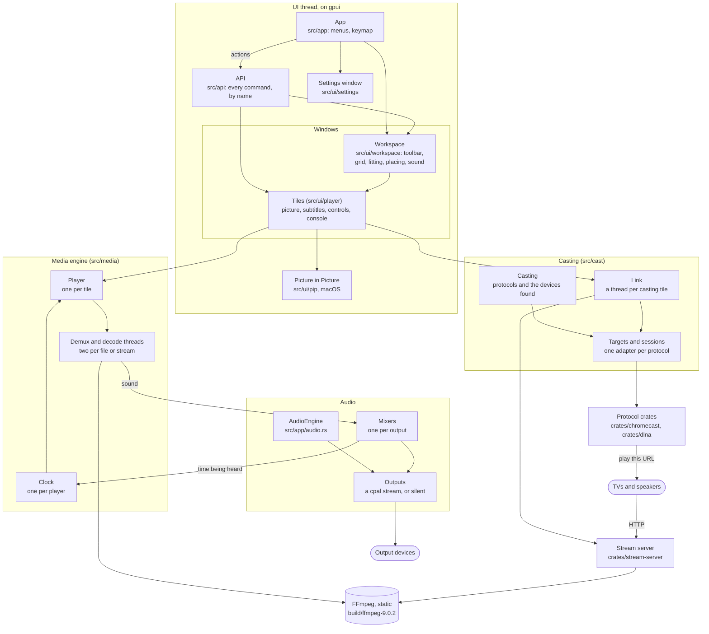
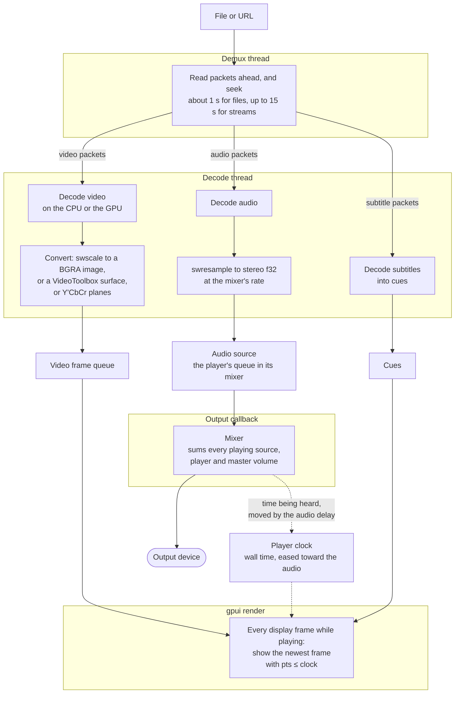
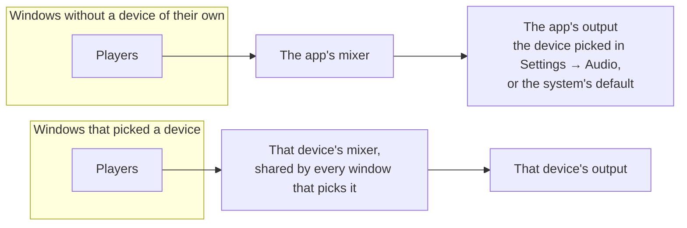
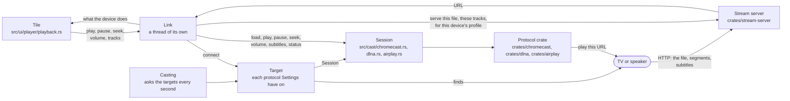
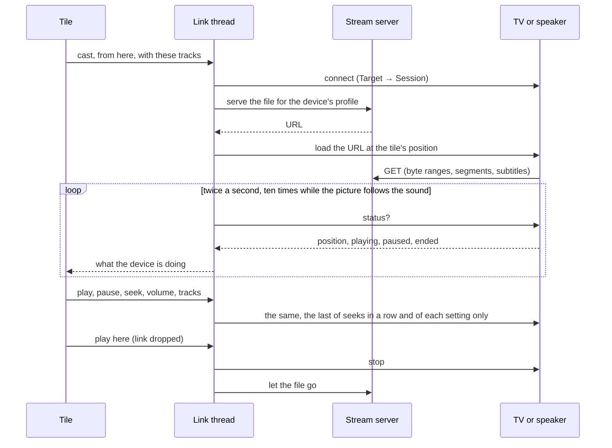

# How Plays works

Plays is written in Rust. Its UI is built with
[gpui](https://github.com/zed-industries/zed/tree/main/crates/gpui), Zed's
GPU-accelerated UI framework, from a patched copy in `vendor/gpui`. Media
is decoded with FFmpeg, built from source and linked in statically. This
file describes how the parts fit together. [README.md](README.md) says what
the app does, and [CONTRIBUTING.md](CONTRIBUTING.md) says how to build and
test it.

- [Overview](#overview)
- [The repository](#the-repository)
- [The media pipeline](#the-media-pipeline)
- [Pictures](#pictures)
- [Sound](#sound)
- [Subtitles](#subtitles)
- [The rest of the media engine](#the-rest-of-the-media-engine)
- [The app and its windows](#the-app-and-its-windows)
- [Casting](#casting)
- [The stream server](#the-stream-server)
- [The Chromecast crate](#the-chromecast-crate)
- [The DLNA crate](#the-dlna-crate)
- [The AirPlay crate](#the-airplay-crate)
- [Linking FFmpeg](#linking-ffmpeg)
- [Vendored gpui and xattr](#vendored-gpui-and-xattr)

## Overview

gpui runs the app on one thread: windows, views, menus and settings.
Every action, from a key, a menu or a button, runs a command of the API by
name, on the window or tile it names or the one in front. Each
open file or stream is a `Player`, owned by its tile, with two threads of
its own that read and decode it. Decoded sound goes into a mixer, which an
audio output plays; the output tells each player's clock what is being
heard, and the tile shows the frame the clock has reached each time gpui
draws. A tile that casts hands its file to a link thread, which drives the
device through its protocol's crate, while the stream server serves the
device the file.

The threads, then:

- the UI thread, where gpui runs everything in `src/app` and `src/ui`;
- two per player, `demux` and `decode` (`src/media/decoder/`);
- two per audio output: one that holds it and opens its devices
  (`src/app/audio.rs`), and cpal's callback, a thread that mixes for an
  AirPlay speaker, or one that runs the mixer in time when there is no
  device (`src/media/output.rs`), with an AirPlay session's own while it
  plays through a speaker;
- while a video opens or a subtitle file is picked, a few that open and
  read its subtitle files (`src/media/external.rs`);
- one per casting tile (`src/cast/link.rs`), and the threads each protocol's
  crate runs its sessions and discovery on;
- the stream server's: one per HTTP connection, and one per job making
  segments (`crates/stream-server`).

## The repository

The repository is a Cargo workspace: Plays, and beside it in `crates/` the
crates it is built from, each built and tested on its own. The workspace's
clippy lints, in the root `Cargo.toml`, apply to all of them.

| Path | What it is |
| --- | --- |
| `src/` | Plays itself. |
| `crates/stream-server` | Serves media to TVs and speakers over HTTP, as they play it or repackaged and re-encoded for them. |
| `crates/chromecast` | Finds Google Cast devices and drives them. |
| `crates/dlna` | Finds UPnP media renderers and drives them. |
| `crates/airplay` | Finds AirPlay receivers, pairs with them and sends to them. |
| `crates/network` | What the three casting crates share on the network: connecting, reading HTTP and RTSP within bounds and in time, and finding devices over mDNS. |
| `crates/ffmpeg-link` | Links the static FFmpeg into Plays and into the stream server's tests. |
| `vendor/gpui` | gpui 0.2.2, patched for Plays. |
| `vendor/xattr` | xattr 0.2.3, which gpui reaches, patched to build on Linux. |
| `script/` | Building FFmpeg, bundling the macOS app, the credits, test fixtures and smoke runs. |
| `resources/` | The credits (`attributions.json`), the macOS `Info.plist` and the Linux `.desktop` file. |
| `assets/` | The app icon, which `script/bundle-macos` compiles into the app bundle, and the UI's icons, which `src/assets.rs` compiles into the binary. |
| `tests/fixtures` | Small media files the tests open. |

Inside `src/`:

| Path | What it is |
| --- | --- |
| `main.rs` | Starts the app, runs the command line, or hands what it was given to the Plays already running. |
| `api/` | Every command Plays has, by name: what each does and takes, and running one on the window or tile named. Every action goes through it. The events it tells whoever listens, and the socket the command line reaches it over. |
| `cli.rs`, `cli/` | The command line: `plays` with a subcommand asks the Plays running over the socket and prints what it answers. |
| `app/` | Starting the app, its menus, keymap, audio outputs and the AirPlay speakers and Bluetooth devices among them, keeping the computer awake, smoke runs. |
| `media/` | The playback engine: FFmpeg decoding, the mixers, clocks, subtitles, HDR. |
| `ui/` | gpui views: windows, tiles, Settings, Picture in Picture, components and theme. |
| `cast/` | Casting tiles to TVs and speakers. |
| `settings.rs` | The settings, saved as `plays/settings.json` in the user's config folder. |
| `progress.rs` | Where each file was when it last played, and the tracks picked in it, kept for 30 days in `plays/progress.json`, so it starts there with them again. |
| `files.rs` | The folder those two files and the AirPlay pairings are kept in, and writing them whole, so a crash never leaves one half written. |
| `hotkeys.rs` | The keys commands take, which Settings can change. |
| `assets.rs` | Icons compiled into the binary, so the app needs no files next to it. |

## The media pipeline

Audio is the master: the picture follows the clock, and the clock follows
the sound being heard. A file with no sound plays on wall time.

- `src/media/decoder/`: two threads per file or stream. The demux thread
  reads packets ahead (about a second for files, up to 15 s for network
  streams so a slow connection doesn't stall decoding) and carries out
  seeks. The decode thread decodes only while its output queues have room,
  so memory stays bounded however much is read ahead. With nothing to do
  it sleeps until rung: by the player sending a command or taking a frame,
  or by the demux thread reading what it waits for. Sound playing makes
  room with nothing to ring, so it sleeps as long as that takes, and a
  quarter of a second at most. It converts video to BGRA `RenderImage`s
  (with the right YUV matrix and pixel aspect), except where frames stay
  on the GPU (macOS) or go over as their Y'CbCr planes (Linux); resamples
  audio to the mixer's rate; and handles accurate seeking: frames no other
  frame refers to aren't decoded on the way to a seek's target. A skip
  (the arrow keys, the skip buttons) is accurate when a keyframe is within
  a second before its target, and otherwise lands on the nearest keyframe
  its way, which shows at once. Dragging the seek bar scrubs: each move
  shows the first frame decoded on its way at once, then one every 40 ms
  or so, then the frame asked for, decoding nothing past it and no sound,
  so nothing waits on buffering. A move up to two seconds past the frame
  decoded last decodes on from there rather than going back to a keyframe.
  Letting go seeks exactly (`playback.seek`), playing on if it played. It plays one track of each kind; picking an
  audio or video track opens a decoder for it and seeks to the playhead,
  so the new track starts where playback is. The other subtitle tracks'
  packets are kept for a few seconds, so a subtitle track picked starts
  with them, without a seek. Either thread failing, by an error or a
  panic, says why for the tile to show, the first to fail standing, and
  the player stops waiting for more. `mod.rs` has the decode thread and
  what it is told: it opens the file's streams, then each time round takes
  the commands, carries out a seek, waits for a skip to land and decodes a
  packet for each queue with room; `demux.rs` the demux thread and its
  packet queues; `video.rs` and `audio.rs` the two decoders; `convert.rs`
  turning frames into pictures. `shared.rs` holds what a player and its
  threads share, behind methods: each seek starts a generation, numbered
  by a serial, and what was decoded or found for an earlier one (frames,
  sound, where a skip landed, the end of the file) is never handed out
  once the next has started, so nothing that takes from it checks the
  serial itself.
- `src/media/player.rs`: the UI-side handle: play/pause/seek, frame
  selection, buffering after seeks (and, for streams, until a second is
  read ahead or when the network runs dry), end-of-file and looping, and
  the console's figures: frames shown and dropped, lateness, and what is
  queued. A tile ticks its player each time it is drawn; while the window
  isn't drawing (hidden or minimized), the window ticks every tile five
  times a second so playback, end of file and looping go on.
- `src/media/clock.rs`: per-player clock that runs on wall time and is
  eased toward the audio position on every audio callback, unless another
  thread has it that moment. Drift too large to ease snaps it.

## Pictures

A decoded picture reaches gpui in one of three forms (`src/media/picture.rs`):

| Form | Where | How it is drawn |
| --- | --- | --- |
| BGRA image | Software-decoded frames on macOS; on Linux, Dolby Vision and formats other than 8- and 10-bit 4:2:0 | Uploaded to gpui's texture atlas. |
| Surface | Hardware-decoded frames on macOS (zero-copy) | Drawn in place from the `CVPixelBuffer`, with gpui's surface shaders. |
| Y'CbCr planes | Most frames on Linux, hardware-decoded ones copied back first | Uploaded as planes, converted (and HDR tone mapped) by gpui's Vulkan shader. |

gpui's Linux renderer can't draw GPU surfaces such as DMA-BUFs, which is
why hardware-decoded frames are copied back there. Either way the tile
paints them itself, framed. Replaced frames are kept a
few display frames in case the GPU is still reading them, then released
(images with `Window::drop_image`, from `src/ui/player/graveyard.rs`), and
so are the pictures of DVD, Blu-ray and DVB subtitles once they are off
screen, so GPU memory stays flat during playback.

Playing four 4K H.264 files at once on an Apple silicon Mac takes about 20%
of one core with zero-copy, against about 100% when hardware frames are
copied back and converted on the CPU.

- `src/media/hwaccel.rs`: shares one hardware device per API between all
  decoders and copies GPU frames back for conversion where they can't be
  drawn directly. If the GPU can't take a stream, or keeps failing on it,
  decoding switches to software.
- `src/media/videotoolbox.rs` (macOS): the zero-copy path. A
  `VTPixelTransferSession` converts each VideoToolbox frame on the GPU into
  the full-range NV12, BT.601 surface gpui's `surface()` element draws,
  scaling it to the display size on the way. Untagged video gets the same
  matrix guess as in software (BT.709 from 720 lines up). HDR frames go to
  10-bit BT.2020 surfaces tagged with their transfer function instead, and
  Dolby Vision frames are only scaled, carrying their reshaping along.
- `src/media/yuv.rs` (Linux): frames handed to gpui as their Y'CbCr planes
  (`yuv420p`, `nv12`, 10-bit `yuv420p10` and `p010`, which hardware decoders
  give), with the matrix from samples to R'G'B' for their YCbCr matrix,
  range and bit depth, and where their chroma samples sit. The CPU only
  copies the planes, or has swscale scale them (still as Y'CbCr) when the
  picture is over the resolution limit or its pixels aren't square; gpui
  converts them to RGB, tone maps HDR and applies the gamma on the GPU.
  Dolby Vision and other formats are converted on the CPU as before, and
  `PLAYS_GPU_CONVERSION=0` sends every frame that way.
- `src/media/hdr.rs`: PQ and HLG, and the tone curve. HDR reference white
  (203 nits) is shown as SDR white, and brightness above three quarters of
  the screen's headroom eases toward it instead of clipping. On the CPU it
  turns HDR frames, scaled to 16-bit RGB by swscale, into 8-bit sRGB.
- `src/media/dovi.rs`: Dolby Vision profile 5, whose pictures are IPT
  rather than YCbCr. Each frame's reshaping curves and matrices (from its
  RPU, which FFmpeg parses) turn it into BT.2020 light like HDR10's. On the
  CPU from 16-bit 4:4:4 planes; for zero-copy surfaces, the curves are
  packed for gpui's Dolby Vision shader instead.
- `src/media/picture.rs`: the forms a decoded picture takes, and the gamma
  for SDR and HDR video that every player shares. Converted frames get it
  on the CPU; surfaces carry it to gpui's shaders each time they are
  drawn, so a change shows at once, even on paused video. Frames converted
  on the CPU share out their rows among up to eight threads kept for it (a
  rayon pool), rather than threads started for each frame; swscale writes
  an SDR frame straight into the picture's own pixels.
- `src/media/orientation.rs`: the eight ways to turn and mirror a picture,
  and the one a video's display matrix asks for.

Where HDR is tone mapped, then: on macOS, VideoToolbox surfaces are tone
mapped by gpui's shader under the screen's current EDR headroom, and
software-decoded HDR on the CPU to SDR; on Linux, on the GPU to SDR, with
Dolby Vision on the CPU.

## Sound

- `src/media/audio.rs`: the mixers, one for each output, which sum all
  players and apply per-player and master volume. A mixer tells each
  player's clock what is being heard, moved by the player's audio delay,
  so the picture runs that far ahead of the sound (or behind it). It plays
  at the output's rate; when a new device wants another, or a player moves
  to another mixer, what is queued is converted to the new rate and
  decoders resample to it from then on. A mixer runs on the output's
  real-time thread, so it neither allocates nor frees, and waits for no
  other thread. What it played stays queued until the decoder lets go of
  it, and no sound is converted to another rate while the list of players
  is held. A lock another thread keeps more than 50 µs it goes on without,
  that player silent for the moment.
- `src/media/output.rs`: where a mixer's sound goes: a cpal stream to a
  device, in the device's own format, or, with no device, a thread that
  runs the mixer in time so players keep playing silently. It lists the
  outputs and finds one by the id the system keeps for it. On macOS it
  adds the latency CoreAudio gives the device's stream, which cpal leaves
  out and AirPlay makes long, to how late what is mixed will be heard, and
  CoreAudio says when outputs come and go. Elsewhere the list is read
  again when it is shown. An output isn't `Send` (a cpal stream isn't
  everywhere), so it stays on the thread that made it. An AirPlay speaker
  connected is played through by a thread that mixes a packet of 352
  frames at a time, at 44.1 kHz, as each is due, telling the mixer when
  it will be heard: the crate's latency, and what an AirPlay 1 speaker
  says it adds, so the picture is held back that much. The speaker going
  away, or ending the session, is heard as the device lost; let go of, it
  is stopped first.
- `src/app/speakers.rs`: AirPlay speakers, and TVs for their sound, as
  outputs, found by the crate's browser on every network and listed beside
  this computer's under ids of their own (`airplay:` and the receiver's).
  One is connected with what pairing with it left, kept in the same
  `Pairings` as a TV cast to, and its own volume is set once, to where it
  says it is. One that wants its PIN says so (`OpenError::NeedsPin`);
  credentials it turns down are forgotten first. `output_kind` says an
  output is reached by AirPlay, which the menus, the cast menu's outputs for
  the window and Settings → Casting's devices found show, so a speaker also
  found by DLNA is told apart; the menu bar adds the protocol only where two
  items would share a name.
- `src/app/bluetooth.rs`: the Bluetooth headphones and speakers paired
  with the Mac (IOBluetooth's paired devices, of the Audio/Video class and
  a minor class that plays sound), listed as outputs while they aren't
  connected, under the id macOS gives their output once they are
  (`coreaudio:`, the address in capitals, `:output`), so a device picked
  is the same one before and after. Picking one, in Settings, the Audio
  menu or for a window, connects it (`openConnection`, on a thread of its
  own), if it's paired and its output isn't there; the engine plays
  through it once it is, as through any device picked that comes back.
  Routing never connects one, so starting the app or a device going away
  doesn't. Only a process whose Info.plist says what it uses Bluetooth for
  (`NSBluetoothAlwaysUsageDescription`, as Plays.app's does) touches
  IOBluetooth: macOS stops one that doesn't, as tests and smoke runs would
  be. Elsewhere, and on Linux, none is listed.
- `src/app/audio.rs`: the `AudioEngine`, which keeps the outputs and which
  device each plays through. The app's output plays through the device
  picked in Settings → Audio, or the system's default. A window may play
  through a device of its own instead: the engine keeps an output, with
  its own mixer, for each device a window picked, shared by every window
  that picks it and closed with the last of them, routed and watched like
  the app's. While a device picked isn't connected, its sound waits for it
  (players keep playing, silently) or goes through the system's default,
  as settings say; the device is looked for every two seconds, and the
  sound goes back to it as soon as it's there. Each output is held by a
  thread of its own, which opens its devices, as finding and opening one
  can take longer than the UI thread can wait: the UI thread asks it to
  route the output, and it says where it did once it has, which the UI
  thread takes if nothing was asked since. The output plays nowhere until
  then, and Settings say which device it is opening. Outputs find and open
  devices through `Devices`: this computer's (`Local`, the system's
  through cpal), the Bluetooth ones paired with it (`Bluetooth`, listed
  only) and the AirPlay speakers. A device that wants its PIN
  isn't looked for; the engine has the window in front ask for it, and
  once it's paired every output not playing through what it wants is
  routed again. In most tests the outputs play nowhere and no device is
  listed or opened; those for speakers give the engine one output of this
  computer's, which plays nowhere, and fake speakers.
- `src/ui/workspace/sound.rs`: a window's sound, through the app's output
  or a device of its own. Its tiles play there, and a tile moved to a new
  window takes the device along. A window Output Device sends full screen
  to another display plays through the output named after that display,
  its speakers, while there, unless a device was picked for it; coming back,
  it plays as it did before. An output is named after a display when its
  words are the display's, or, failing that, when it is the one output
  whose words take in the display's or are taken in by them.

## Subtitles

- `src/media/subtitles.rs`: subtitle cues. Subtitle packets are decoded as
  soon as they are read. FFmpeg turns every text format into ASS lines, of
  which the words, line breaks, italics, bold and top/middle/bottom placement
  are kept; bitmaps become images placed as fractions of the picture. A
  cue without an end (as in PGS) lasts until the next one. Cues show by the
  playhead less the subtitle delay. Seeks keep them, from a minute before
  the playhead to a minute after, so stepping or skipping back shows the
  ones just over at once (even one that started before the keyframe the
  seek reads from), and moving subtitles later brings them back. A cue read
  again is kept once.
- `src/media/external.rs`: subtitle files beside a video: finding them,
  reading their names, and telling a text file's encoding (with
  `chardetng`) for FFmpeg's iconv to convert. The files beside a video are
  opened, to see what they hold, while it opens, eight at once. A picked
  file is read whole on a thread of its own, as a bitmap one can be tens
  of megabytes and on a share far away, those shown before going on until
  it is. Its packets are decoded two seconds ahead of the playhead, from
  30 seconds before it once read and after a seek, so cues already showing
  are there.
- `src/ui/subtitles.rs`: paints a tile's cues on the picture it frames, in
  the style from Settings, turning and cropping bitmap ones with it; the
  settings' Subtitles pane draws its preview with the same code.
- `src/ui/overlay.rs`: draws subtitles into pixels rather than with gpui,
  for screenshots and Picture in Picture: text laid out by `subtitles` as
  on a tile showing just the picture, drawn with the glyphs gpui
  rasterizes, and bitmaps stretched where the stream places them.

## The rest of the media engine

- `src/media/source.rs`: files and stream URLs. URLs are logged without
  credentials or query strings. Folders are listed (for the media files in
  one dropped, and a file's previous and next and all of them, which Go
  to… offers) in the background, as they may be on a network drive, and
  by name without looking at each file.
- `src/media/details.rs`: what the console shows of the file's format and
  the streams playing, read from their decoders before they decode.
- `src/media/colors.rs`: a video's range, matrix, primaries and transfer,
  read from its decoder and frames as numbers. ffmpeg-next reads them as
  enums with gaps, which a file's numbers can fall in (Matroska's demuxer
  passes them on unchecked), and that is undefined behavior; a number
  FFmpeg has no name for is unspecified here instead. `clippy.toml` keeps
  ffmpeg-next's own getters for them out of the code.
- `src/media/tracks.rs`: the tracks a file has, and their names for the
  menu (language, title, forced and SDH, codec, channels); the languages
  Plays knows, each kept by its first code (`language`), offered A to Z
  (`languages`), and the same in any form or region (`same_language`).
- `src/media/picking.rs`: which tracks play as a file opens (`Wanted`,
  which `PlayerOptions` hands the decoder thread, which opens them): the
  audio and subtitles picked in it before (`Picked`, which `progress`
  keeps), if it has them, or none if its subtitles were hidden; else in
  the first language Settings → Audio or Subtitles prefer that it has;
  else the audio FFmpeg finds best, and a subtitle file beside the video,
  else the file's default subtitles or forced ones. A tile notes what is
  picked in it, from the track menu, a shortcut or a command, as
  `select_track` plays it.
- `src/media/chapters.rs`: a file's chapters, read with its info (their
  times from the start of the file, in order), and which one a time is
  in, the next and the previous. Going back within the first couple of
  seconds of one goes to the one before, as on a disc player; later, to
  its start.
- `src/media/still.rs`: a frame decoded again on its own for a screenshot:
  the file opened again, sought to the keyframe before the frame shown and
  decoded in software up to it (found by its timestamp), then converted at
  full size, tone mapped as playback does, or as BT.2020 PQ or HLG.

## The app and its windows

- `src/api/`: every command Plays has, which every action runs by name,
  as the command line and the command palette do. Each namespace
  (`app`, `window`, `view`, `tile`, `playback`, `audio`, `subtitles`,
  `video`, `cast`, `output`, `display`, `settings`, `cli`) is a file in
  `commands/`, a
  list of `Spec`s: the command's id (`playback.toggle_loop`), title,
  description and keywords,
  what it acts on (the app, a window, every tile in one, or a tile), the
  arguments it takes, the keys it starts out with and where they work
  (`Reach`: anywhere, in a window with files, or there but not while
  typing), what it does, its state (on or off, the chapter) where it
  has one, and what it hands back (`returns`), where it hands back
  something: the JSON's shape, which `describe` gives with the rest. A
  query (`Spec::query`: `app.inspect`, `window.ls` and `window.inspect`,
  `tile.ls` and `tile.inspect`, `output.ls`, `display.ls`, `cast.ls`,
  `settings.ls`, `settings.get`, and `settings.keymap`, every command's
  keys as they are now) only reads: it takes no keys, and running one between two others
  leaves `api::ran_before` as it was, so a walk back goes on. What they
  say of a window and its tiles is in `workspace::inspect` (a window's
  title as its title bar shows it, and a tile's window's), and of a
  tile in `player::inspect`: tracks and chapters numbered from 1, the
  volume in percent, the delays to the millisecond, the video's frame
  rate, and a stream's URL as the tile shows it, without its user,
  password or query.
  `registry` finds them; `args` checks the arguments given against what
  the command takes before it runs, then reads them into a type of the
  command's own, which also has where it was run from (`Source`); `target` finds the window and tile named: by id, then by
  label, then by position from 1 (windows in the order they opened, tiles
  in the window named or in front), then by the end of an id, with an
  error if none is or several are; `#` and a number name by position
  alone, as ⌘1 to ⌘9 name windows (`window::focus`); named by nothing,
  the window in front
  and the tile in it keys go to. Windows and tiles get an id as they're
  made, a number never given again, mixed so ids made one after another
  differ at the end, and shown as eight hex digits. `api::run` runs an
  `Invocation` (the command, its arguments, what it's aimed at and where
  it came from) and answers with JSON or an `Error`, which says what went
  wrong: no such command, arguments it doesn't take, nothing by that name
  or more than one, or that it failed. It updates the window it acts on,
  so it's called outside any window's update; `api::dispatch` runs it once
  the event is handled. Keys and menu items send one gpui action,
  `api::Run`, which carries the invocation: `api::register` handles it
  with `dispatch`, and enables a menu item only when its command can run
  (`api::can_run`), through the menu validator Plays adds to gpui. A
  command needs nothing more to take keys or be in a menu. A window's
  controls run their commands too, aimed at their own tile
  (`PlayerView::send`) or window (`Workspace::send`): the buttons, the
  tracks and cast menus, the toolbar, the empty window's buttons, the
  Open URL form (`app.open`), a tile dropped on another (`tile.move`) and
  a tile asking to pair (`cast.pair`), and casting there again once
  paired. Dragged, the seek bar and the volume slider follow the mouse
  in the tile, and send `playback.seek` or `audio.set_volume` once let
  go. What the app does in a window that is no command, asking for an
  output's PIN, goes through the same target resolution once the event is
  handled (`api::in_window_later`). In tests, `api::record` notes every
  invocation run, and `api::intercept` notes them without running them.

  `api::events` tells whoever listens what changes, each a JSON object,
  `{type, payload}`, which the socket passes on to the command line. A
  listener hears the app's (windows opening, closing, renamed and coming
  to the front; the outputs, where the sound goes and the devices to cast
  to; settings by key and shortcuts by command; each command run, from
  where; and the socket's clients connecting and leaving), one window's
  (its label and full screen; its tiles coming, moving in from another
  window or going; its layout, the tile filling it and the one keys go
  to; and how each tile plays: opened, or not, playing, paused, ended,
  sought, its volume, tracks and chapter, casting and Picture in
  Picture), or all of them (`Scope`). A payload about a window or a tile
  starts with its `window_id` and `window_title`, and `tile_id` and
  `tile_title`: the title its title bar or header shows (`WindowSeen` and
  `TileSeen` keep it), a window's its label or else Plays
  (`Workspace::title`), a tile's its label or else what it plays; one
  closed is named as it was. Readers ignore what they don't know. Where
  each tile is goes only to those who ask, at most once
  a second (`POSITION_EVERY`), and only once it has moved. Each event of
  how a file plays says where it is as `seen::playhead` does: how far
  through it is from 0 to 1, the time, and the frame showing, counted at
  the video's frame rate with a millionth of a frame to spare, as a
  frame's own time multiplied back can fall a hair short of it.

  What changed is found by looking: `events::look` reads the app, every
  window (`Workspace::seen`) and tile (`PlayerView::seen`) into a `Seen`
  and tells what differs from the last look (`seen::changes`), in order:
  the app's, the windows opened, each window's own, then its tiles coming
  and going, its layout, then how each tile plays, the windows closed,
  and the one in front. So each change is told once, whatever made it: a
  command, a click, a file opening or reaching its end. It looks once a
  command has run and what it set off has settled (`api::run` defers it:
  a window a command opens is numbered only once it's made), and every
  `LOOK_EVERY` while anyone listens; no one listening, it doesn't look,
  and forgets what it saw. A command is told before it runs, aimed where
  and from where; a query, which only reads, isn't. Settings, kept apart
  from the windows, are told from an observer as they change
  (`fields::changed` says which). A tile tells the file opened in place of
  another apart by `Playback`'s count of openings, and a seek, here or on
  the device it casts to, by its count of seeks; a file opened starts out
  paused, as its `opened` says the rest, so one that plays tells
  `playing` and no more.

  `api::socket` is how the command line, and another Plays, reach the
  one running. `main` takes the socket first (`socket::start`), before
  FFmpeg or gpui start: it's in a folder only this user can open (0700,
  made if it isn't there: the app's settings folder on macOS,
  `$XDG_RUNTIME_DIR/plays` on Linux), and only they can connect to it
  (0600). A lock file beside it (`plays.lock`) is held while it looks, so
  two Plays starting at once take turns. If a Plays answers there, this
  one hands it the files and URLs it was given and exits with the
  answer's status (`client::hand_over`). Paths are made full first, as the
  one running may have started in another folder; URLs go as given. A
  socket no one answers, left by a Plays that crashed, is removed and
  taken. Only a socket is removed: anything else there is an error, and
  Plays runs without a socket. Tests and smoke runs have none, unless
  `PLAYS_SOCKET` names one, which any build takes in place of its own
  (the `cli` smoke run does). The
  protocol (`protocol`) is JSON, an object a line. Each request has an id
  and a method: `hello`, `call`, `commands`, `describe`, `subscribe`,
  `unsubscribe` or `hand_over`. Each is answered in order, with its
  `result` or an `api::Error` and a message (`bad_request` for one that
  can't be read). Events come between answers, `{type, payload}`. The
  server (`server`) takes clients on a thread and numbers them from 1;
  two more threads each read from and write to a client. What a client
  asks runs on the UI thread, in order: a call through `api::run` from
  `Source::Cli`, with the menus checked after, as a key's command. A
  hand-over runs `app.open`; with nothing to open it focuses the window
  in front (`window.new` if there's none). Either way Plays comes forward
  (`cx.activate`), in front of the terminal the files came from. A
  subscriber's events come from `events::listen`, through a task that
  sends each as it's told. Before an answer, those told and still
  waiting are sent first, so a subscriber's own command's `command_run`
  comes before the answer; what the command changes comes after, once it
  has settled. A client is cut off if it stops reading with `OUTBOX`
  lines waiting for it, or sends a line over a mebibyte. Calls and
  subscriptions are answered only while Settings has control from the
  command line on (`command_line_control`, off until it's turned on
  there), and refused otherwise with `not_allowed`; `hello`, `commands`,
  `describe` and `hand_over` are answered either way, so `plays FILE…`
  and `plays version` work. Turning control off lets go of every client:
  each is taken off the list, so it hears nothing more, and told
  `client_left`, its connection closing once what it was sent is written.
  `client_connected` and `client_left` are told to the app's listeners.
  The socket is removed as Plays quits. `client` is the other end: one
  request at a time, keeping the events that come meanwhile for
  `next_event`, or `next_event_by` a deadline, a line read in part kept
  for the next read. `connect_or_start`, for the command line, starts
  Plays when none answers (`start_plays`, apart from the terminal) and
  waits up to ten seconds for its socket.
- `src/cli/`: the command line. `main` asks `cli::wanted` before
  anything else is set up, so it never starts gpui or FFmpeg: a
  subcommand, one of its options, `help`, or a word that is no file or
  folder there (a subcommand mistyped) is the command line's; files,
  folders and URLs are handed to Plays as before. clap reads it (`args`).
  A `Session` connects as it first needs Plays (`connect_or_start`, with
  nothing to start under `--no-autostart`) and runs the API's commands with `-w`
  and `-t` as their `Target`. `do` reads each `KEY=VALUE` as the
  command's argument takes it, from the registry compiled in: text as
  given, the rest as JSON if it reads as JSON; a key given again makes a
  list. `windows` lists windows with their tiles and runs the window and
  tile subcommands: those named are found by id first, so closing or
  moving one doesn't change which window the next number names, and a
  place beside another counts from where the others are once the one
  moving has left its own. `events` subscribes to everything
  (`Heard::All`), or to the window `-w` names, and prints each event, a
  line of `type key=value…` or of JSON; `wait` subscribes before it looks
  at the tile, so nothing happens unheard in between: a tile that has
  ended already prints its `ended` at once, as the event says it, from
  `tile.inspect`'s position, duration and frame rate; the tile or window
  closing first, or the time running out, fails the wait. `reference`
  lists the commands from the registry compiled in, Plays running or not,
  and writes `docs/commands.md` (`plays actions --markdown`). `completions`
  writes the script that completes the command line in bash, zsh, fish or
  Nushell (clap_complete, clap_complete_nushell), from clap's command with
  the registry's ids, each with its title, as what `do`, `api describe` and
  `api call` take, and the settings' keys for `settings get` and `set`, the
  cast protocols' too, none of them started. clap's script for fish
  completes options alone, so lines of its own offer those words, each
  until one of its names is given; its script for Nushell offers names
  alone, so each of its completers lists records instead, a name with its
  title where it has one. `show` prints tables, events and results. The exit status is the error's (1 failed,
  3 not found, 4 unreachable, 5 control from the command line off), 2 for
  a bad command line, clap's or one of its own checks; output closed
  (`| head`) ends it quietly with 0.
  Commands it relies on: `tile.focus` puts a tile in front and its window
  too; `cli.install` links `/usr/local/bin/plays` to the program running,
  through a link made beside it and renamed over, replacing a link but
  nothing else, and says what to type with `sudo` where it can't write
  (making `/usr/local/bin` too, if it isn't there). Run from anywhere but
  a command line (the menu, Settings, the palette), it says so in an
  alert over the window in front, opened once that window is free, whose
  Copy Command copies what to type.
- `src/app/`: starting the app (`mod.rs`; files and links the system
  opens it with run `app.open`), the shared audio outputs (`audio`,
  above), the keymap (`keymap`: every command's
  keys from Settings, and ⌘1 to ⌘9, bound again whenever they change) and
  the menu bar (`menus`: commands by id, each item titled as its command,
  sending its `Run`, checked when its state is on and enabled when it can
  run; set again after a command runs, as settings change, and as
  outputs, displays, devices to cast to or player windows come and go; a
  menu named Window, which macOS adds its own window items to, opens,
  names and closes windows, maximizes, names and moves the tile in front,
  goes from tile to tile and window to window, and back, and numbers
  windows; Move Tile To has a place for each tile in the window in front,
  Move Tile to Window each other window, by label or number, and Move
  Window To a number for each window; File → Open Recent the files played
  lately, each by its name, with its folder where two share one, sending
  `app.open`, and set again as they change). `windows`
  numbers the player windows in the order they open, as each `Workspace`
  is made, for ⌘1 to ⌘9, unless `window.move` puts one at another number;
  steps from the window in front to the next or the one before for
  Ctrl+Tab and Ctrl+Shift+Tab; and keeps when each was last in front, as
  each comes to the front, in a `history::FocusHistory`, which each
  window's tiles have one of too. From that, `window.recent` (⌘') brings
  back the newest before the one in front, so twice comes back, and
  `window.back` walks back: each step goes only to windows in front
  before the one it last went to, until another window comes to the front
  otherwise or another command runs (`api::ran_before` says which command
  ran before this one). Those keys work in
  every window, Settings and About too, but while Settings records a
  shortcut. `awake` keeps the screen awake
  while a video plays, and the computer while only sound does: a power
  assertion on macOS, the desktop portal's Inhibit on Linux. `smoke` runs
  the real app through scripted scenarios (see
  [CONTRIBUTING.md](CONTRIBUTING.md#smoke-runs)).
- `src/hotkeys.rs`: the keys of every command that takes them (one with
  no arguments, that needs nothing named), which Settings can change, how
  they are saved and shown (`⌃⌘F`, `Ctrl+Alt+F`), and their key bindings.
  Each key runs its command's `Run` in the key context its `Reach` gives:
  a player window's keys in `Workspace && !TextInput`, so space and
  letters type in a text field; ⌘W and ⌘⇧W, for the file in front, in
  `Workspace`; and those that work anywhere (and not in `TextInput`, for
  one without ⌘ or Ctrl) everywhere else. None works in `Recording`, so
  Settings and the palette can record them. `record` and `unrecord` add
  and take away a command's key and save the keys with `settings.set`,
  for both. A
  key goes to one command of those that work in player windows and one of
  those that work anywhere; the player window's is bound last, and wins
  there. The settings file keeps only the keys changed, each under the
  name the command had before commands had ids (`play_pause`), else its
  id, and reads either.
- `src/settings.rs`: the settings, saved as JSON in the user's config
  folder with the version of Plays they're from. Each value is read on
  its own, so one a setting can't take (typed wrong, or from a later
  Plays) leaves only that setting as it starts out; a file not read
  whole, or from a later Plays, is kept beside it as `settings.json.bad`.
  `settings::fields` lists every setting by its key, the path to it in
  the file (`subtitles.size`), with what the Settings window calls it, its
  pane, and what it takes: on or off, one of the choices the window offers
  (which the panes draw from the same lists), a number in the window's
  range, a font the system has, a folder, an output, the shortcuts
  changed, or languages (by name or code, kept by code, each once); and
  whether each protocol looks for devices
  (`casting.look_with.Chromecast`), for the protocols there are. `with`
  sets one, checked so, by laying the value into the settings as JSON and
  reading them back, which the type checks too. The `settings` commands
  read, set, reset and list them through it, read the file again
  (`settings.reload`, saying which changed) and show it.
- `src/files.rs`: the folder the settings and progress are kept in, a gpui
  global the app sets to `plays` in the user's config folder; tests and
  smoke runs have none, so they never read or write the real files, and a
  test of them gives a folder of its own. And writing them whole: to a
  file beside first, on the disk, then renamed over the old one, so a
  crash or losing power midway leaves the old one as it was. A private
  file, as the AirPlay pairings are, is made readable by its owner alone
  (on unix) before anything is written to it, and one left beside by a
  crash is removed first, as it could be anyone's. Paths are shown with
  the home folder as `~` (`shown`).
- `src/recents.rs`: what was used lately, the latest first, each once, a
  list in a file of its own beside the settings: the last 8 commands run
  from the palette (`recent-commands.json`) and the last 20 files played
  (`recent-files.json`), by full path, noted as a tile opens one or plays
  another in its place. File → Open Recent and Go to… offer them, and
  `app.clear_recent_files` forgets them.
- `src/progress.rs`: where each file was when it last played, and the
  audio and subtitles picked in it (`picking::Picked`), by its whole
  path, kept for 30 days in `progress.json` beside the settings. Tiles
  note it as they close or open another file, every 10 seconds while
  files are open, and as the app quits; a tile opening a file seeks to
  it and plays the tracks picked. A file barely begun, or played nearly
  to its end, keeps no place, only its picks if it has any; with neither
  it isn't kept.
- `src/ui/`: gpui views (`open_url`, the player and Settings below) and a
  text field based on gpui's input example (`text_input`), framed as a
  control, or bare inside a field that holds more, as the palette's
  search does its magnifier. `name_sheet`
  asks what to call something, holding its name: Return names it, blank
  for none, and what it names can refuse a name, the sheet saying why;
  `window.rename` and `tile.rename` with no label show it. A window's
  label (`workspace/naming`) is its title, a tile's shows in its header in
  place of its file's name, titles off or on, and each is a name the API
  knows it by, no two windows' the same and no two tiles', in whichever
  windows.
  - `displays` lists the displays by the names macOS gives them (on X11,
    each monitor by its product's name; on Wayland, each output by the
    compositor's description) and moves a window onto one, which gpui
    can't. New windows open on the display in use. It looks at them, and
    where each is, once a second and keeps what it saw for the menus and
    Black out, as asking is slow on X11, a few round trips to the X server
    for each.
  - `framing` works out how a tile's picture shows: the file's
    orientation, then the tile's turns, flips, aspect ratio and crop, as a
    size to fit and where to sample the frame.
  - `screenshot` saves a tile's frame: bitmap subtitles laid on it, then
    turned and cropped on the CPU as `framing` says, then text subtitles,
    and written as PNG (with `png`, which can tag HDR) or JPEG.
  - `blackout` covers the other displays while a window is full screen,
    with plain black windows of the system's own rather than gpui's, as
    nothing is drawn in them and they must never take the focus: on macOS
    above the menu bar and Dock, on every Space; on X11 one per monitor,
    override-redirect so the window manager leaves it alone. Wayland lets
    no app place windows, so there it does nothing.
  - `traffic_lights` fades the macOS traffic lights with the controls;
    gpui draws them over the video but has no way to hide them.
    `system_colors` reads macOS's own colors and the accent color from
    AppKit. `about` is the About window.
- `src/ui/workspace/`: a window, one per window, a file per part: opening
  files, folders and streams (`opening`), the tiles, putting one in
  another's place, maximizing one, and moving one to another window or
  one of its own, where it plays on (`tiles`), sizing the
  window for its videos (`fit`: as they open, unless the window was
  resized meanwhile or is zoomed, and when Video → Match Video Size asks,
  zoomed or not; never in full screen), the grid, where a tile
  dragged onto another lands (`grid`), going from tile to tile and moving
  them about the grid from the keyboard (`focus`: the tile beside, above
  or below the one in front, as the grid lays them out, or the one before
  or after it in turn; and back to one in front before, by `tile.recent`
  and `tile.back`, as for windows, from when each was clicked, gone to
  from the keys or moved in from another window, but not as the mouse
  passes over it, which only puts it in front), the empty window (`empty`: the app's logo, from
  `assets/icon.svg`, with the open buttons or the URL form under it;
  pressed anywhere but those, which keep their presses, and dragged, it
  moves the window as a lone tile's picture does), its screensaver
  (`screensaver`: left alone in front, the window fades its buttons out
  and the logo bounces off its edges, a new color at each, from the one it
  rests in (a click on it picks the next; back from bouncing, it keeps
  the one it had), till it's used again and the logo flies back. Where
  the logo is follows from the time
  alone, read from gpui's executor, so tests see it on the fake clock; the
  empty window and the logo's place are noted as they're laid out, for it
  to bounce in and fly back to, and a task waits for the window to have
  rested, let go whenever the window is drawn unable to rest), the toolbar
  (`toolbar`), the mouse coming, going and resting, and the traffic
  lights (`mouse`), floating on top (`on_top`), where windows open and come
  back to (`place`: the player window in front or closed last, in
  `window.json`, and Settings as it moves, saved in `settings-window.json`
  as it closes, which quitting does too), going full screen on another display (`display`: out
  of full screen, across, and in again), the window's sound (`sound`), and
  what the Playback commands do to every tile (`commands`).
- `src/ui/player/`: a player's tile, a file per part: what fills it
  (`content`), the header, the controls, the track menu, notes on what
  shortcuts did (`osd`, with the track reel), the `console`, what
  shortcuts do to it (`commands`, `adjust` for the picture, `sync` for
  delays and `screenshot`; `pip` runs Picture in Picture for it, `cast`
  casts it), dragging it by its picture (`drag`: with gpui's drag and drop
  onto another tile, or the window with `Window::start_window_move` when
  no other tile shows, once the mouse has gone further than a click would,
  which the empty window shares), and the graveyard frames wait in before
  they are released.
  Settings' `over_video` says which panels show over the video: the header
  and controls hidden aren't drawn (nor counted as hovered, nor kept clear
  of by subtitles, and the menus from the controls close); `osd` has two
  kinds of note, `note` for what's wrong or why a shortcut did nothing,
  which always shows, and `note_change` for what a shortcut changed, which
  hidden notes leave unsaid, as a hidden track switcher leaves the reel
  unrolled.
  `playback` holds the tile's player and the device it casts to, and every
  command the tile sends goes through it: only that file can command the
  player, the rest of the tile reading it. While a tile casts, its play,
  pause, seek, volume, loop and track changes go to the device, Picture in
  Picture's buttons too, and what it shows (position, playing, the end)
  comes from it; the slider seeks the device once it's let go, and frame
  steps and delays do nothing. Where the player here is commanded while
  the tile casts, its method says so: the picture following sound heard
  elsewhere, and the player taking over again when the cast ends. Picture
  in Picture closes, and isn't offered, while the picture plays on the
  device.
  The window tells each tile where it is, in one `TileLayout`: in front,
  with a ring round it (put in front from the keyboard, among other tiles,
  until the mouse moves or clicks), maximized, alone, in the top-left
  corner, and whether the mouse is in the window and resting. The tile redraws when that changes.
- `src/ui/pip/` (macOS): Picture in Picture. The tile's frames go, as they
  are due, to an `AVSampleBufferDisplayLayer` hidden over the tile, which
  AVKit's `AVPictureInPictureController` shows in the system's window; a
  delegate of Plays' own answers its buttons. The layer's timebase runs
  and stops with playback, whichever buttons played or paused it, and
  moves the window's progress bar. The tile pumps its player on a timer of
  its own, since gpui stops drawing a covered window: until the next frame
  is due while it plays, ten times a second while paused, and at once when
  the window's buttons are pressed. VideoToolbox surfaces go tagged with
  their colors (HDR included); other frames are copied into BGRA buffers,
  and turned or mirrored videos are turned on the GPU. AVKit moves the
  layer's video into its window at a size and scale of its own rather
  than fitted to it, so Plays keeps it filling the window, looking through
  the layers over it for one AVKit put there when the window changes, and
  twice a second besides. AVKit does that again each time the frames
  change size, so once the window is open every frame is scaled to its
  pixels on the GPU (`Fitting`), with subtitles or without: were only
  frames with subtitles scaled, the window would blink zoomed in as they
  came and went. Subtitles can't go over the video there, so the ones
  showing are drawn into those frames (`burn_in`), in the frame's own
  signal and samples.
- `src/ui/settings/`: the Settings window. Each pane (Playback, Audio,
  Video, Subtitles, Casting, Screenshots, Hotkeys, Appearance, Command
  Line, About) is a
  file of its own with its name and icon for the sidebar; `form` has the
  cards, rows and sliders they are made of, and `file` the settings file's
  menu at the sidebar's foot; `languages` the list of languages Audio
  and Subtitles each prefer, whose rows move up or down or go, with Add
  Language's menu. Each control sets its setting with
  `settings.set` (`form::set`), once the event is handled; a slider shows
  its setting as it's dragged, unsaved, and sets it once let go, and
  Hotkeys sets the shortcuts changed, or resets them. Importing a file and
  resetting every setting replace them whole. Hotkeys lists every command
  that takes keys, a card for each namespace; while it waits for keys to
  record, its key
  context has `Recording`, which every command's keys stay out of.
  About shows the version, Plays' license and what it is built with:
  FFmpeg, dav1d and GPUI, crediting the Zed team, from
  `resources/attributions.json`, each opening to its license, one at a
  time; not every crate.
- `src/ui/palette/`: the command palette, `window.command_palette` (⇧⌘P),
  a sheet over the window it opens in (`workspace/command_palette`), which
  it runs every command on, an App one on the app. It lists the commands
  `api::can_run` says can run there, none that are queries or need a
  target named, each with its state (`api::state`: ✓, or a value) and its
  keys. `search` finds what's typed: each word, its letters in order,
  in a title, a namespace's name or a keyword, letters starting a word or
  side by side counting for more, the title most. Those run from it
  lately (`recents`) come first when nothing is typed and count for more
  when something is. A command's arguments are asked for one by one
  (`asking`): from a list where there is one (tracks, chapters, windows,
  displays, devices, outputs, settings and their values, an argument's
  own choices), what's picked now first and checked, asked by running
  the queries (`tile.inspect`, `display.ls` and so on) once the window
  is free; or typed, a time, a number in range, a path or a URL, read as
  the argument takes it and said why not until it will do. Change
  Shortcut (`shortcut`) lists the command's keys in place of the rows,
  under their heading, Default by those it starts out with: the palette
  takes the focus from its field and its key context has `Recording`, so
  a key pressed, but for the arrows, Return and Escape, reaches its
  `on_key_down` and is added (`hotkeys::record`), a note saying whose it
  was; Return or a click removes the key picked, and Escape goes back to
  the commands, their keys as they are now. With nothing typed, the
  rows are under a heading for each namespace, Recent first (`Line`); found,
  they're ranked with none, each saying its namespace after its name.
  Each row fills the list, inset as far as the field is from the
  card's sides (`theme::palette::INSET`), its keys at its end: a
  `uniform_list` lays out each line on its own, where a flex box is only
  as wide as what's in it and its margins are dropped, so each line goes
  in a plain box, which fills the list, padded by the inset
  (`Palette::inset`). Its text is the panel's, as a menu row's is
  (`text_sm`), the field's too, and the headings, the footer and the
  command's chip a hint's (`text_xs`). The row picked is filled with the
  accent color, and pointing at one
  picks it, so the mouse and the arrows move the same row. A footer says
  what Return does and Change Shortcut's ⌘↩, each in a keycap and each
  clickable. It shows up to `ROWS` rows; in a window too short for them it
  ends `theme::palette::MARGIN` above the bottom, the card no taller than
  its room (`max_h_full`) and the list, the one part that can give way,
  shrinking, so the field and the footer stay whole and the list scrolls. Go to… (`window.go_to`, ⌘P) is
  the same sheet listing places (`places`): the windows (`window.ls`),
  the tiles in each (`tile.ls`, with their window where there are two or
  more), the media files in the front tile's folder, as it last looked
  through it, and the files played lately (with their folder), under a
  heading for each kind, and found as commands are, by its name, its
  kind or where it is. Each runs
  its command from the palette: `window.focus`, `tile.focus`,
  `playback.play_file` in the front tile, or `app.open` in the window.
  ⌘P over the command palette, or ⇧⌘P over Go to…, puts one in the
  other's place.
- `src/ui/components/`: the reusable components, one `RenderOnce`
  component per file, each in three sizes (small, medium, large) with its
  numbers for each in `theme`. An icon; a button in seven variants
  (normal, primary, secondary, danger, ghost, link, icon) with its icon
  on either side, and selected or disabled; a switch, a segmented control,
  a slider (with notches, which the seek bar puts at chapters) and a meter;
  menu rows, and a popover that opens a menu from a button; a badge; a flat
  card; and a floating panel to put anything in, a menu's or a note's over
  the picture, which shows the picture through it as Settings say.
- `src/ui/gallery.rs`: in debug builds only, the Developer menu's
  Component Gallery (`app.show_components`): every component in each of
  its sizes and states side by side, to check by eye, the switches,
  segments, sliders and menu rows working. Commands for working on Plays,
  as this one is, are marked `developer` and left out of the command
  reference, which release builds would otherwise differ from.
- `src/ui/theme.rs`: colors, every size, radius and duration the UI uses,
  the backdrop each look of the panels over the video has, and named text
  styles (`text_display`, `text_title`, `text_heading`, `text_label`).

## Casting

- `src/cast/`: casting. A protocol is a `Target`, which finds devices (a
  name, what they show, video or sound only, and an address) and connects
  to one for a `Session`: what it plays, for the stream server, then load,
  play, pause, seek, volume, subtitles, stop and status. Each protocol's
  crate is adapted to these (`target.rs`). A device to be paired with
  first says so as it's connected to (`NeedsPin`), and its target pairs
  with it (`pair`), which has it show a PIN and finishes with the one
  typed. `Casting`, a global, keeps the protocols, starting each one
  Settings have on looking (its target) and dropping it when turned off,
  which stops it looking. It is dropped on a thread of its own, as
  stopping waits for the target's threads to end, which can take a second,
  and the windows would stop drawing meanwhile; a cast to one of its
  devices goes on, its link holding the target. It asks the targets every
  second what they have found, and starts the stream server for the first
  cast, on every interface.
- `src/cast/link.rs`: a tile's `Link` runs its session on a thread of its
  own, as every call may wait on the network: it connects, has the stream
  server serve the file with the tracks the tile plays, and loads it at
  the tile's position; then it does what the tile sends it (of seeks in a
  row only the last, and of what it sent while the device was being told
  something else only the last volume, looping and subtitles), asks the
  device what it is doing twice a second (ten times while the picture
  follows the sound), and shows the tile what it asked for until the
  device has done it. A video's sound sent to a speaker is the one cast
  with the picture here: the tile keeps playing with its sound unheard,
  playing and pausing as the speaker is seen to and following where it
  says it is, the time it said it at moved on to now; its clock eases
  there, and seeks where it is far off. Dropping the link stops the device
  and the stream server lets the file go; as the app quits, where each
  device was is kept to resume from, and the app waits a moment for the
  devices to stop, those cast to from windows closed before too. The next
  or previous file goes on to the device once it's known what it holds,
  which decides whether a speaker gets its sound alone and which subtitles
  go with it.
- `src/cast/dlna.rs` adapts the DLNA crate: it asks each renderer found
  what it plays (its protocol info), which decides whether it shows video
  and how the stream server serves it (the files it lists, else a stream of
  MPEG-TS rather than HLS, which fewer TVs take; H.264 and AAC in MPEG-TS
  for one that doesn't say; for a speaker given a video's sound, a stream
  of AAC or FLAC, by what it lists), and names the MIME type as the
  renderer lists it. While the picture follows the sound it asks the
  renderer where it is ten times a second. A stream of the sound starts
  where its URL says: a speaker refuses to seek in one and says how long it
  is as how much it has played, so it's given the stream from where it's to
  start, again to seek, and where it says it is counts from there, against
  the file's duration. Subtitles go as SRT, both ways the crate writes them;
  other subtitles load the file again from where it is. The renderer
  stopping after it played is the end; a seek it refuses while stopped is
  made once it plays; something else playing there ends the cast. DLNA has
  no volume for the media apart from the renderer's own, so the tile's
  scales that.
- `src/cast/chromecast.rs` adapts the Chromecast crate: devices that show
  video are offered for anything, speakers and groups for sound; the model
  each says it is decides how the stream server serves it, and HLS made for
  it says its kind of segments, which the receiver otherwise takes for
  MPEG-TS. Subtitles go as a WebVTT track styled from Settings, beside the
  HLS rather than in it; off and on is the track's, other subtitles load the
  media again with a track at a URL it hasn't fetched. The tile's volume
  is the stream's. Played to the end, it's loaded again to play again; it
  going idle stopped, or unable to play, ends the cast, as the crate's ways
  of ending do.
- `src/cast/airplay.rs` adapts the AirPlay crate: receivers that show
  video are offered for video, and speakers aren't cast to, as they're
  outputs (`src/app/speakers.rs`), paired with through it too
  (`AirPlayPairing`). It connects
  with the credentials kept for the receiver, which says it needs its PIN
  when there are none; credentials it turns down, as after it was reset,
  are forgotten and it's paired again. The model it says it is decides how
  the stream server serves it, always as HLS (fragmented MP4 for HEVC and
  HDR on an Apple TV 4K and an Apple TV HD, MPEG-TS on older ones and
  other makes' TVs) with the subtitles in the playlist, which the receiver
  draws in its own style. It reads the playlist only once, so other
  subtitles give it the media again from where it is, at a URL with a
  query of its own, which the stream server ignores. The tile's volume is
  the receiver's. Played to the end it says nothing of what it played, and
  is given the media again to play again, from where it was sent since.
- `src/cast/pairings.rs`: what pairing with AirPlay receivers left, kept
  in `plays/airplay.json` in the user's config folder, readable by its
  owner alone, with the id they know this computer by, made once.
  `AppPairings`, a global, shares it between the AirPlay target, the
  speakers and Settings → Casting, which lists the receivers paired with and forgets
  one. Tests and smoke runs keep them in memory only.
- `src/ui/pairing.rs`, `src/ui/workspace/pairing.rs`: the pairing sheet. A
  tile whose cast was turned down for want of a PIN ends its cast and asks
  to pair (`cast.pair`), and the audio engine asks the window in front for
  an output's speaker that wants one, unless a sheet is up already. The
  window puts a sheet over itself, which pairs on a thread of its own, as
  each step waits on the network, and looks at how it goes ten times a
  second. A wrong PIN has the TV show another, which the sheet asks for.
  Paired, the tile casts to it again (`cast.to`), or the outputs that want
  the speaker play through it. Closed without pairing, cancelled or failed, the tile
  plays on here, and what picked the speaker picks it no longer
  (`AudioEngine::not_paired`, once the window is done updating): the
  app's output goes back to the system's default, and a window's to the
  app's, rather than wait, silent, for a speaker not paired with.
- `src/cast/fake.rs` is a protocol for tests: devices the test adds and
  takes away, which do as they are told, keep what they were told, and say
  what the test has them say.

## The stream server

`crates/stream-server` serves media to TVs and speakers over HTTP: a
protocol's crate tells a device to play a URL, and this crate makes that
URL. It knows nothing of Plays or gpui, so it is tested on its own.

- `profile.rs`: what a device plays, as its protocol's crate knows it: the
  containers it takes as files, HLS (with MPEG-TS or fragmented MP4
  segments), a progressive MPEG-TS stream or a progressive stream of the
  sound alone (AAC as ADTS, or FLAC), and the codecs, size, bit
  depth, HDR kinds and channels it decodes; whether the HLS playlist lists
  the subtitles, which it doesn't for a device given them beside it.
- `media.rs`: opening a file or stream and reading what is in it. Colors
  and pixel formats come from FFmpeg as C ints, read as numbers and made
  Rust enums only when FFmpeg names them: a file can hold any number.
- `plan.rs`: the least work that plays. The file as it is, or a stream's
  own URL, when the device plays it with the default tracks; else HLS, or
  for a DLNA TV without it an MPEG-TS stream, and for a DLNA speaker given
  a video's sound a stream of it alone, each track copied when the
  device decodes it and re-encoded when it doesn't. Video is re-encoded to
  H.264 or HEVC (10-bit and HDR kept in HEVC where the device shows them),
  no bigger than the device shows; sound to AAC, AC-3, E-AC-3 or (for a
  stream of FLAC) FLAC. Picture subtitles picked from the media are drawn
  into video re-encoded; video copied goes without them.
- `encode.rs`: the hardware video encoders only, VideoToolbox on macOS and
  NVENC or VA-API on Linux, one that opens remembered, one that doesn't
  left alone at that size for a minute (its sessions may be in use);
  FFmpeg's own sound encoders, through a resampler and a FIFO of whole
  frames. The resampler keeps the sound where its times put it: a gap in
  it is filled with silence, and sound overlapping what came before is
  dropped, once either is past 20 ms, so the sound after doesn't drift
  from the picture. A 10-bit encoding keeps the source's colors, those
  FFmpeg names; others are left unknown, as unspecified ones are.
- `segments.rs`: where a file's segments start. Copied video can be cut
  only at its own keyframes, read from the file's index (or, with none, by
  reading the file); re-encoded video and sound alone are cut every six
  seconds, with a keyframe made there. A file is at most 100,000 segments
  long, about a week: one claiming to last longer is taken to end there.
  Copied video with keyframes more than five segments apart is re-encoded
  instead (copied as it is only where it can't be), as each segment is
  held whole while it is made and served.
- `mux.rs`: fragmented MP4, MPEG-TS, ADTS or FLAC written into memory of
  its own, cut into segments where told and each handed over as it is
  rather than copied out of FFmpeg's. Every timestamp is moved ten seconds
  later, so none is negative and segments made by different jobs line up.
- `job.rs`: making them. A job reads from where a segment starts, copies
  or re-encodes, and cuts where the leading stream (video, else sound)
  reaches the next segment's start, holding the other stream's packets
  past it until then. Jobs run three segments ahead of the device and
  wait; asking for one far from the job (a seek), or behind it and no
  longer kept, starts another there, and a segment is cut the same way
  whichever job makes it. Packets without a length get one from the next.
  A file's read failing partway (a network share's, say) fails the job, so
  the segments past it are made again when asked for, not served empty as
  past the file's end; a live or progressive stream ends there, with what
  was read. A live stream has one job, keeping the last ten segments and
  listing six. A file that never says how long it is goes the same way,
  but its job too waits three segments ahead of the device, so it isn't
  read to its end before the device starts. A progressive stream is made
  for each request, from the time it asks for. A file's segments and a
  live stream's are read through the same loop, which hands each packet to
  what cuts them.
- `overlay.rs`: picture subtitles drawn into video as it is re-encoded.
  The track's packets are decoded as the media is read; a display set
  shows until the next or its own end, and one with nothing in it clears
  the screen. Its pictures, their canvas stretched over the frame
  (interpolated larger, averaged smaller), are blended into each NV12 or
  P010 frame in the frame's colors, their white at graphics white in PQ
  and HLG.
- `subtitles.rs`: a text track of the media, or a subtitle file (from the
  encoding it is said to be in), read once and written as WebVTT (whole, or
  for each HLS segment, mapped to the media's timestamps) or SRT, keeping
  italics and bold.
- `playlist.rs`: the master playlist (bandwidth, size, frame rate,
  subtitles, and codec names read from each stream's parameter sets) and
  the media and subtitle playlists, each made once for a file.
- `http.rs`, `server.rs`: a small HTTP/1.1 server with a thread for each
  connection, at most 64 at once, kept open between requests for 30
  seconds, in which the next request's head must all come: GET, HEAD and
  OPTIONS, byte ranges, CORS for Chromecast, and DLNA's headers (content
  features, time seeks, Samsung's subtitles header). Each cast is served
  under a random token, at the address the device reaches this computer
  at, and only to that device. The app starts the server for a cast and it
  stops once no cast uses it.

It re-encodes video only on a hardware encoder, so a computer without one
(Linux without NVENC or VA-API) can't cast video a device doesn't play as
it is.

## The network crate

`crates/network` holds what the Chromecast, DLNA and AirPlay crates share
on the network, so a fix in one reaches them all.

- `connect_first`: a device on more than one network has an address on
  each, and not all reach it from here, so each is tried in turn.
- `http`: HTTP and RTSP messages read off a connection. A head is at most
  64 KiB, its lines ending in CRLF or LF alone; a body comes by its
  `Content-Length`, in chunks, or to the end of the stream when the caller
  says it may, and is at most a megabyte. Lengths are checked before
  anything is added to them. A reader keeps what it read past one message
  for the next, as AirPlay's connection carries many. `Deadline` gives a
  whole message its time, each read waiting only as long as is left, so a
  device sending a byte at a time takes no longer than a whole message may.
- `mdns`, with the `mdns` feature: browsing for one or more service types
  on threads of their own, and the devices their records make. A device's
  records are put together by its id, the newest of each type counting;
  what a protocol makes of them, and which types it browses, is its
  `Protocol`.
- `Found`, what browsing says of a device (added, changed, gone), and
  `lock`, which takes a mutex a panic left poisoned.

## The Chromecast crate

`crates/chromecast` finds Google Cast devices (Chromecasts, Google TVs,
Nest speakers and speaker groups) and has one play a URL, then drives it.
It knows nothing of Plays, gpui or FFmpeg, blocks on the caller's thread or
a session's own, and says what happens over a channel.

- `browser.rs`, `device.rs`: mDNS for `_googlecast._tcp`, with `network`'s
  browser; a record's TXT gives the id, name (`fn`), model (`md`), what it
  does (`ca`: video out, sound out, a group) and what it's showing (`rs`).
- `channel.rs`, `proto.rs`: TLS to the device (rustls; each device signs
  its own certificate, so any is taken, though the handshake is checked
  against it), and on it Chromium's `CastMessage` protobufs, each after its
  length, carrying JSON. Whatever comes after the device closes TLS is
  dropped, and a device that takes nothing of a write for ten seconds is
  gone: the connection closes, which ends the cast.
- `session.rs`: a cast. It connects to the device, launches the Default
  Media Receiver (or joins it) and connects to that; requests wait for the
  answer with their request id. A thread reads everything the device says:
  it answers pings and pings every five seconds, and passes on media
  status and volume as events. The cast ends when the device goes away or
  says nothing for 15 seconds, when the app closes or another one
  launches, or when another sender plays something else.
- `media.rs`: what LOAD takes (the URL, its type, buffered or live, a
  title and duration, WebVTT subtitle tracks, which to show and how they
  look, and for HLS its kind of segments) and the status read back: idle
  and why, buffering, playing or paused, with the position and duration.
- `fake.rs`, with the `fake` feature: a pretend device on this computer,
  TLS with a certificate made for it.

`cargo run -p chromecast --example chromecast -- list` lists the devices
on the network; `play` casts a URL to one and says what it does with it.

## The DLNA crate

`crates/dlna` finds UPnP media renderers (smart TVs from Samsung, LG, Sony
and others, and speakers such as Sonos or Devialet), has one play a URL and
drives it. Like the Chromecast crate it knows nothing of Plays, gpui or
FFmpeg, blocks on the caller's thread or a session's own, and says what
happens over a channel.

- `ssdp.rs`, `browser.rs`: SSDP. A search for media renderers goes to
  `239.255.255.250:1900` on every interface, again a second later as
  datagrams get lost, and every two minutes after; renderers' NOTIFYs are
  heard on SSDP's port, shared with whatever else listens there. A
  renderer is dropped when it says byebye or isn't heard from within the
  max-age it gave. Renderers are found over IPv4 only, and a description
  is fetched only from the address its advert came from, by one of four
  threads, at most 64 waiting for them. At most 256 renderers are kept.
  One that moves is read again where it's gone; if that read fails, as
  when it says where it is before it answers there, it's kept as it was
  and read when next heard from.
- `device.rs`, `xml.rs`: the device description, read for the name,
  maker, model, icons and where AVTransport, RenderingControl and
  ConnectionManager are, of any version. The renderer may be a device
  inside another, as a Sonos speaker's is. Only URLs on the host the
  description came from are taken, and none with spaces or line breaks,
  so a device can't have Plays ask anything of another. ConnectionManager's
  protocol info is read into capabilities: the protocol, MIME type and
  DLNA profile of each.
- `http.rs`, `soap.rs`: just enough HTTP/1.1, read with `network`'s
  reader, and SOAP actions on it. A URL's host is a name or an IPv4
  address, or an IPv6 one in brackets (with a zone, as the events
  callback's own address may have), and its port is digits only, so
  nothing else goes into the Host header and a URL reads back as it's
  written. A response has its time as a whole, however slowly it comes,
  and is at most a megabyte after its head. A refusal's `UPnPError`
  becomes a typed fault, as each service numbers them.
- `media.rs`: the DIDL-Lite that goes with a URL (title, class, `res`
  with its protocol info, duration and size), with subtitles both as a
  second `res` and as Samsung's `sec:CaptionInfoEx`, as DLNA has no
  subtitles of its own. What serves the media matters as much: TVs look
  for `transferMode.dlna.org`, `contentFeatures.dlna.org`, time seeks and
  `CaptionInfo.sec`, which the stream server sends, and a speaker seeks in
  a file by byte ranges.
- `session.rs`: SetAVTransportURI (after Stop, for a renderer that won't
  take another while it plays), Play, Pause, Seek (by absolute time when
  it won't by relative), Stop, the volume and mute. GENA subscriptions to
  AVTransport and RenderingControl send their events to a listener of the
  session's own, renewed halfway through; GetPositionInfo is asked every
  second, or as often as the session's told, with the transport state, and
  the volume every five seconds, when there are no events for them: a
  service subscribed to counts as evented only once an event has come from
  it, as some never reach us (a firewall stopping them, say). A position
  is taken as heard halfway between the asking and the answer, when it
  first comes: a renderer saying where it is to the millisecond may move
  it on only once a second. The session ends when the renderer stops
  answering, or when it plays something it wasn't given here: what it's
  set to play, asked afresh, isn't ours. A renderer that neither sends
  events nor answers GetPositionInfo can't be followed. The events
  listener looks for a connection every 50 ms rather than waiting in
  `accept`, which nothing could wake once the Mac changed network and its
  address was gone. Ending the session stops the polling thread first, so
  a renewal under way is answered before the subscriptions are ended.
- `fake.rs`, with the `fake` feature: a pretend renderer on this computer,
  a TV with events or a speaker without, saying where it is and how long
  what it plays is to the millisecond and, when told to, slow to answer an
  action or a renewal, or with events that never come.

`cargo run -p dlna --example dlna -- list` lists the renderers on the
network and what they play; `play` has one play a URL, with subtitles
when given, and says what it does.

## The AirPlay crate

`crates/airplay` finds AirPlay receivers, pairs with them and sends to
them: a TV is told to play a URL (one the stream server makes) and driven
while it does, and a speaker is sent live sound. Like the other two it
knows nothing of Plays, gpui or FFmpeg. It blocks, on the caller's thread
or a session's own, and what a session says as it goes comes over a
channel. Plays casts to TVs with it (`src/cast/airplay.rs`) and plays
through speakers (`src/app/speakers.rs`, `src/media/output.rs`).

- `browser.rs`, `device.rs`: mDNS for `_airplay._tcp` and `_raop._tcp`,
  with `network`'s browser, a receiver's two records put together by its
  id, and read for whether it shows video, plays sound and speaks AirPlay
  2, and how it pairs: once with a PIN it shows, for each session only, or
  not at all. An AirPlay 1 speaker that doesn't say its features, as older
  ones don't, plays sound. A receiver at one of this computer's own
  addresses (but loopback's) is its own AirPlay Receiver, which macOS has
  on, and is left out.
- `tlv8.rs`, `srp.rs`, `pairing.rs`: HomeKit pairing. With the PIN (SRP-6a
  with SHA-512 and the 3072-bit group, then long-term Ed25519 keys swapped
  under ChaCha20-Poly1305), which leaves credentials to keep; transient,
  for receivers open to everyone; and pair-verify with the credentials,
  for each session after. Proofs are compared in constant time. A
  receiver that answers pairing `403 Forbidden` lets only some senders
  play to it, as its settings say (a Mac's own user's devices, at first,
  or a home's people): that is `Error::Refused`, and Plays says what to
  change on it (`cast::airplay::turned_away`).
- `channel.rs`, `message.rs`, `connection.rs`: the control connection,
  RTSP and HTTP requests on one TCP connection, encrypted once paired in
  frames of up to 1024 bytes. A receiver on more than one network has an
  address on each, and not all reach it from here, so each is tried in
  turn. An answer is read with `network`'s reader, so its body is at most
  a megabyte, and must come whole within ten seconds, however slowly: the
  deadline is under the encryption, as a frame is read as one. It must
  carry its request's CSeq. A request that fails, or gets the answer to
  another, closes the connection, as what comes next on it could be a late
  answer or the rest of a frame cut short; later requests fail at once.
- `session.rs`: AirPlay 2's session. SETUP says who we are, by the
  sender's id (made up in a MAC address's form, for the caller to keep and
  give back so receivers know it again; `/play` says it too), and where
  our clock is, which the receiver asks the time; the receiver talks back
  on an event connection; feedback goes every two seconds. An AirPlay 1
  speaker, which has neither, is sent OPTIONS every two seconds instead.
  Feedback or OPTIONS refused or unanswered, or the event connection
  closed, is the receiver gone, and stopping the session then asks nothing
  more of it (no `/stop` or TEARDOWN, which could wait on a receiver
  that's gone). Dropped, a session stops its threads (the clock's,
  feedback or OPTIONS, events, resends) and closes its connections,
  whether it was stopped first, let go, or failed partway through setting
  up.
- `video.rs`: `/play` with the URL and where to start, `/rate`, `/scrub`
  and `/stop`, and `/playback-info` read as loading, playing, paused or
  ended.
- `audio.rs`, `rtp.rs`: 16-bit stereo PCM at 44.1 kHz in RTP packets of
  352 frames, each sent as it is due: to AirPlay 2 speakers as realtime
  audio, sealed with a key sent in SETUP, and to AirPlay 1 ones plain. An
  AirPlay 1 speaker that takes sound only encrypted gets each packet in
  AES-128 CBC, from the same IV each time, with the key and IV in the
  ANNOUNCE, the key wrapped (`rsa.rs`: RSA-OAEP with SHA-1) with the
  public key every AirPort Express holds the private half of. A sync
  packet every second ties RTP time to the clock, and the last thousand
  packets are kept to send again, to the receiver alone when it asks, each
  found by how far it is from the oldest kept. A frame is heard 1.5
  seconds after it's sent, plus what an AirPlay 1 speaker says it adds.
- `fake.rs`, with the `fake` feature: a pretend receiver on this computer,
  for tests here and in Plays. An encrypted AirPlay 1 fake holds a key
  of its own, made for it, rather than the AirPort's, and senders here
  wrap the sound's key for it with that.

AirPlay is Apple's own protocol, unpublished; the crate speaks it as others
have worked it out, so an update to a TV or speaker can break it. It
doesn't take receivers with a password, or AirPlay 1 speakers that take
sound only in FairPlay or MFi encryption. Sound goes uncompressed, which a
busy Wi-Fi network may not keep up with.

`cargo run -p airplay --example airplay -- list` lists the receivers on
the network; `pair`, `play` and `tone` pair with a TV, have it play a URL,
and play a quiet tone on a speaker.

## Linking FFmpeg

FFmpeg is built once from source by `script/build-ffmpeg` into a folder
named for its version, `build/ffmpeg-9.0.2`, where `.cargo/config.toml`
points the build (see [CONTRIBUTING.md](CONTRIBUTING.md#building)).
ffmpeg-sys-next makes FFmpeg's Rust bindings from its headers, and makes
them again only when `FFMPEG_DIR` changes, so a new version, in a new
folder, gets new bindings in every profile.

`build.rs`, with `crates/ffmpeg-link`, links the static FFmpeg with what
it needs in turn, read from its pkg-config files (dav1d, zlib, iconv, and
macOS's frameworks or Linux's OpenSSL and hardware decoding libraries),
and the C compiler's runtime library they call into, from the compiler
`CC` names (which may be behind a wrapper such as ccache), looked for
again when an update of the compiler moves it. Linking is a crate of its
own because a build script's link arguments reach only its own package,
and the stream server links FFmpeg too. `build.rs` also dates the build
for About: the day of `SOURCE_DATE_EPOCH` for a reproducible build, else
today.

## Vendored gpui and xattr

Plays uses gpui 0.2.2 from a copy in `vendor/gpui`, through
`[patch.crates-io]` in `Cargo.toml`, because it needs things gpui doesn't
have: HDR video, video frames converted on the GPU on Linux, pictures drawn
turned and cropped, backdrops, check marks on menu items, floating windows,
control over displays and full screen, and test support. Everything Plays changed is marked "Plays" in the code;
`vendor/gpui/PLAYS.md` lists it all. In short:

- Its macOS window draws in half floats and extended sRGB, everything but
  video as before, and a second surface shader decodes PQ and HLG and tone
  maps them under the screen's current EDR headroom, with the same math as
  `hdr.rs`. A third one reshapes Dolby Vision as `dovi.rs` does. Every
  surface is drawn with the gamma Plays attaches to it.
- On Linux, its Vulkan renderer uploads video frames' planes to textures
  of their own and a shader converts and tone maps them the same way.
- Images and surfaces can be drawn turned, mirrored and cropped, by where
  they are sampled, so a change costs nothing per frame.
- Elements can have a backdrop: what was drawn under them, blurred, dimmed,
  tinted or bent through a glass edge, from copies of it halved on the GPU.
  This is how the panels over the video look as Settings → Appearance
  says.
- Corners can be superellipses, menu items can show a check mark (macOS),
  a window can float above other apps' windows (macOS and X11; on macOS
  still in Mission Control and ⌘`'s round of the app's windows, which
  macOS gives only windows at the normal level unless they ask), and
  `start_window_move` moves a macOS window with the mouse, as gpui already
  did on Linux.
- Displays have names, and on X11 each RandR monitor is a display rather
  than the whole X screen. A window can go full screen on a display picked
  (X11 moves it there first; Wayland asks the compositor, which may ignore
  it), go full screen over just its own display instead of in a Space of
  its own (macOS), and open where it is asked and stay there (X11). On
  Wayland, a window out of full screen takes back the size it had when the
  compositor leaves the size to it.
- Text can be laid out and rasterized into memory, for subtitles in
  screenshots.
- The app can say which menu items are enabled, as every Plays item sends
  the same action, and a binding's context such as `!Recording` holds in
  a window that sets none.
- Text that doesn't wrap is measured again for the width it's cut short
  to, so a truncated label ends in "…" rather than being clipped.
- Its test platform takes the system's own text system, extra displays,
  and counts activations, a window lists the text it drew, and
  `gpui::render_offscreen` (macOS) draws with the real renderer off screen
  and reads the pixels back, for Plays' tests.

`vendor/xattr` is xattr 0.2.3, which gpui reaches, building on Linux with
today's libc; its `PLAYS.md` says what changed and when to drop it.
